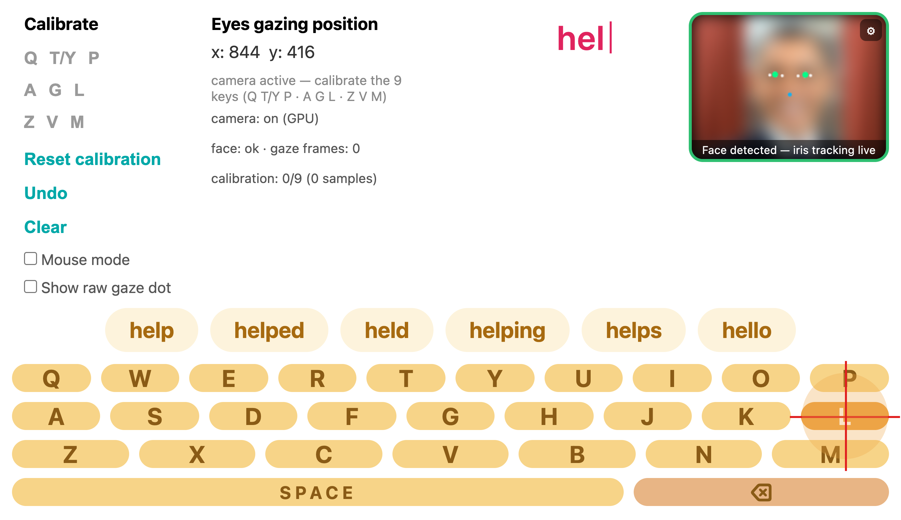

# EYEQ — Type With Your Eyes

An on-screen keyboard you operate by looking at it. No special hardware — just
an ordinary webcam and a browser.



*Above: the keyboard in use. The panel top-right shows the tracker following the
eyes; the crosshair is resting on **L**, filling its dwell timer; the chips are
word suggestions. The face is blurred for privacy — the tracking markers on top
of it are not.*

---

## What it does

Look at a key for about 0.7 seconds and it types. A language model offers word
completions, so you rarely have to spell a whole word.

Two things make this hard, and the project is really about both of them:

1. **Where are you looking?** Turning a low-resolution webcam image of a face
   into a point on the screen.
2. **Which key did you mean?** Turning a noisy point plus the sentence so far
   into a committed character.

---

## Quick start

```bash
pip install -r requirements.txt
python3 app.py
```

Open <http://127.0.0.1:8321>, allow camera access, then click each of the nine
calibration spots (Q, T/Y, P, A, G, L, Z, V, M) and click its dot five times
while looking at it. That takes about a minute. After that, gaze typing works.

Calibration is saved in your browser, so you only do it once per device.

---

## How it works

```
webcam frame → 478 face landmarks → 12 features → ridge regression
             → screen (x, y) → dwell timer → committed key
```

The interesting part is the **12 features**. Most webcam gaze systems measure
where the iris sits between the eyelids. That sounds reasonable and it is a
mistake: your eyelids move when you squint, blink, or sit in bright light, and
none of that means your eyes moved.

We measure the iris against the **canthi** instead — the inner and outer corners
of the eye, which do not move. In the screenshot above, those are the white dots
either side of each green iris marker.

That one change is the project's main result. It cut gaze error by a third.

---

## Results

Measured on **11 recorded sessions from 9 people**, always on screen targets the
model never trained on.

| | Gaze error |
|---|---|
| Eyelid-relative (the usual approach) | 5.55° |
| **Canthus-relative (ours)** | **3.76°** |

A **32.3% reduction**, and *every one of the nine people improved* — by between
19.5% and 44.6%. Statistically: *t*(8) = 9.31, *p* = 0.000014.

The canthus measurement is also immune to head tilt by construction — rotate the
head 40° and the feature changes by about 10⁻¹⁵, which is floating-point noise.

---

## The quantum part, and why it didn't help

The keyboard decides which key you meant by combining *where you looked* with
*what word you're probably typing*. The usual way multiplies two probabilities
together. We built something more general: a **quantum conditional selection
rule** that puts the candidate letters in superposition, gives each a phase as
well as a magnitude, and lets them interfere — something multiplying
probabilities cannot do.

We proved it contains the ordinary method exactly as a special case, then
measured it against that method on identical input.

**It made no difference.** Median −0.03 percentage points; zero significant wins
and zero significant losses across five noise levels.

We think the *reason* is the more useful finding. For interference to help, it
would need to penalise wrong letters more than right ones. It does the opposite.
The correct letter after an English prefix is usually the one with the most
possible continuations — so it carries the widest spread of phases, and therefore
the *lowest* coherence. The mechanism works; its sign is backwards, and no amount
of tuning fixes a sign.

The code is kept at `quantum/conditional_selection.py` as a research module. It
does not steer the deployed keyboard.

---

## The paper

A 6-page IEEE conference paper is in `report/paper/`:

- `report/paper/eyeq_conference6.tex` — the paper
- `report/paper/figs/` — its figures

Reproduce the numbers in it:

```bash
python3 eval/gaze_bench.py            # gaze accuracy, in px / degrees / key widths
python3 eval/feature_ablation.py      # the canthus result
python3 eval/selection_rule_bench.py  # the quantum selection rule
python3 eval/lopo_validation.py       # leave-one-participant-out
```

---

## Repository layout

| Path | What's in it |
|---|---|
| `app.py` | The server. Serves the keyboard and the word-suggestion API. |
| `static/` | The keyboard itself — gaze tracking, calibration, dwell selection |
| `static/iris-tracker.js` | Landmarks → screen coordinate (the front end) |
| `clusters.py` | Key-region maps and the consistency check |
| `decoder.py` | Turns ambiguous region sequences back into English |
| `train.py` | Dataset prep and model training |
| `eval/` | Benchmarks, the recording tool, and the recorded sessions |
| `eval/sessions/` | 11 sessions from 9 participants (coded P01–P09) |
| `quantum/` | The selection rule and other quantum experiments |
| `report/paper/` | The IEEE conference paper |

**A note on the data.** `eval/sessions/` holds real recorded human gaze. It is
de-identified — landmark coordinates and screen geometry only, no video, no
names. It is committed on purpose: it is the least reproducible thing here, and
every accuracy number depends on it.

---

## Things we tried that didn't work

Kept so nobody rebuilds them on a hunch. Each was implemented, measured on
recorded sessions, and removed.

| Idea | What we measured | Verdict |
|---|---|---|
| Iris radius as a distance cue | +0.4% — inside the noise | dropped |
| Explicit head-pose features | +5.7% alone, but nothing on top of the canthus frame (*p* = 0.44) | rejected — the canthus frame is already head-attached |
| Kernel ridge instead of linear | wins on a pooled split, but at the 9 calibration points the system actually collects its margin is 2.9% and not significant (*p* = 0.90) | not deployed |
| Quantum kernel regression | 131%–254% *worse* than the linear model over 4–10 qubits | rejected — fidelity kernels concentrate exponentially; mean off-diagonal similarity falls 0.128 → 0.014 from 4 to 12 qubits |
| Phase interference between word hypotheses | median −0.03 pp; 0 wins, 0 losses | not deployed (see above) |
| Amplitude amplification | dwell 2.63 → 2.80 frames, accuracy 98.4% → 96.4% | not deployed — the thing it speeds up isn't our bottleneck |
| Two-level region selection | ~20 points more reliable per choice, but doubling the dwells cost 25% throughput | rejected |
| De-rotating the eye region before detection | no gain in live use | reverted — the landmarker appears to do this internally already |

---

## Known rough edges

- **Glasses are not supported.** Lenses bend the apparent iris position, reflect
  under overhead light, and the frame can hide the outer eye corner — which is
  the landmark everything here is built on. We have not tested spectacle wearers
  and the accuracy above should not be assumed to hold for them.
- **Unstable fixation is not supported.** The method assumes you can hold a
  gaze steady. Nystagmus, strabismus and similar conditions break that
  assumption by design, not by accident. A blink- or scanning-driven keyboard is
  the right design there.
- The default layout is called "9 clusters" in the code but defines **eight**
  letter regions; digit 8 is unused. Harmless — encoding and decoding share one
  table — but don't be confused by the name.
