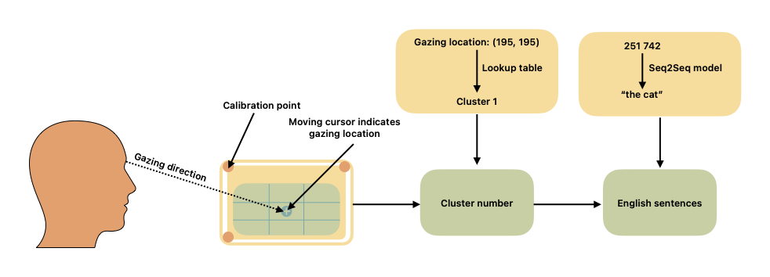

# Eye Gaze Keyboard — Touchless Typing

A complete eye-gaze typing system: a webcam-driven on-screen keyboard divided
into spatial clusters, plus a training pipeline and a **cluster-constrained
hybrid decoder** that translates gaze-cluster sequences back into English.



## How it works

The QWERTY keyboard is divided into spatial regions. Each key maps to a
cluster digit (9-cluster default):

```
[q w e] → 1    [r t y u] → 2    [i o p] → 3
[a s d] → 4    [f g h]   → 5    [j k l] → 6
[z x c v] → 7    [SPACE]      [b n m] → 9
```

Fixating on a cluster for a dwell threshold commits its digit; SPACE commits a
word boundary. "hello how are you" is typed as `51663 531 421 232`, and the
decoder translates it back.

## The decoder (the novelty)

Cluster typing is inherently ambiguous — every letter in a cluster produces
the same digit, so `742` is both "cat" and "car". A raw seq2seq model can even
hallucinate words that don't match the gazed clusters at all. This project
decodes in three tiers, in order:

1. **Exact lookup** — a word code with exactly one known candidate decodes
   deterministically. On unambiguous vocabulary this tier is 100% accurate by
   construction.
2. **Constrained lattice search** — ambiguous codes expand to candidate words
   from a 16k-word frequency vocabulary; a beam search scores paths with a
   bigram language model. Every path re-encodes to the input, so the output is
   always *cluster-consistent*.
3. **Seq2seq disambiguation** — a fine-tuned BART/T5 model proposes beams,
   but a hypothesis is accepted **only if it re-encodes exactly to the input
   clusters**; otherwise the model rescores the lattice paths instead. The
   neural model resolves ambiguity but can never contradict what the user gazed.

Every response reports its decode method and a `consistent` flag.

**A note on "100% accuracy":** perfect accuracy on all inputs is
information-theoretically impossible — distinct sentences can share one
encoding (`742` = cat/car). What this design guarantees instead is (a) exact
decoding whenever the input is unambiguous, and (b) for ambiguous input, the
most probable *consistent* sentence, never an inconsistent hallucination.

## Setup

```bash
pip install -r requirements.txt
```

## Usage

**1. Prepare the dataset** — converts English text (first column of a
tab-separated file, e.g. [Tatoeba](https://www.manythings.org/anki/fra-eng.zip))
into cluster sequences, and builds the decoder vocabulary (`vocab-9.json`):

```bash
python train.py prepare --input data/eng-fra-original.csv --clusters 9
```

**2. Run the eye-gaze keyboard** (works immediately — no training needed;
the lattice decoder runs standalone):

```bash
python app.py                                  # http://127.0.0.1:8321
MODEL_DIR=cluster_to_text_model python app.py  # with seq2seq disambiguation
```

Grant webcam access and face the camera until the preview box border turns
green (the box gives alignment hints: move closer / center your face). Then
calibrate: click each corner button (TL/TR/BL/BR) and click the dot 5 times
while looking at it. Gaze at a cluster to type; dwell on SPACE between words;
dwell SPACE twice (or click Translate) to decode. Calibration persists across
reloads; any later click while gazing refines it. No webcam? Tick **Mouse mode**.

### Gaze tracking (custom, no WebGL required)

`static/iris-tracker.js` implements its own gaze estimator instead of using
WebGazer: MediaPipe FaceLandmarker supplies 478 face landmarks including the
iris rings (GPU when available, automatic CPU/WASM fallback when WebGL is
disabled), and gaze is computed from where each iris sits inside the eye
opening plus head position — an 8-feature vector mapped to screen coordinates
by a ridge regression fitted to the user's calibration clicks.

**3. Train the seq2seq model** (optional, improves disambiguation):

```bash
python train.py train --model facebook/bart-large --fp16 --epochs 4
# quick CPU/MPS smoke test:
python train.py train --model google-t5/t5-small --epochs 3 --max-samples 5000
```

**4. Inference from the command line:**

```bash
python train.py infer --vocab vocab-9.json --text "51663 531 421 232"
python train.py infer --vocab vocab-9.json --model cluster_to_text_model --text "51663 531"
```

**5. Evaluate decoder accuracy** on held-out sentences:

```bash
python train.py eval --vocab vocab-9.json --samples 500
python train.py eval --vocab vocab-9.json --model cluster_to_text_model --samples 500
```

## Cluster configurations

| Clusters | Grouping |
|----------|----------|
| 9 | qwe / rtyu / iop / asd / fgh / jkl / zxcv / bnm |
| 7 | qwert / yuiop / asdfg / hjkl / zxc / vbnm |
| 5 | qweasdz / rtfgxc / yuhjvb / iopklnm |
| 3 | qwertasdfgzxc / yuiophjklvbnm |

Fewer clusters = coarser input = harder translation task, but more tolerant
of gaze imprecision.

## Project layout

| File | Purpose |
|------|---------|
| `clusters.py` | Cluster maps, encoding, consistency check (single source of truth) |
| `train.py` | `prepare` / `train` / `infer` / `eval` pipeline |
| `decoder.py` | Cluster-constrained hybrid decoder (lookup → lattice → seq2seq) |
| `app.py` | FastAPI server: keyboard UI + `/api/decode` |
| `static/` | Keyboard UI: iris-landmark gaze tracking, calibration, dwell selection |
| `static/iris-tracker.js` | Custom gaze estimator (MediaPipe iris landmarks + ridge regression) |
| `data/eng-fra-original.csv` | Tatoeba corpus (English column is used) |
| `eval/capture.html` | Recording protocol: 13 fit + 8 hold-out targets, 5 fixations each |
| `eval/capture.py` | Capture server; writes sessions to `eval/sessions/` |
| `eval/gaze_bench.py` | Gaze-accuracy benchmark — px, degrees, key-pitch, by screen region |
| `eval/test_gaze_bench.py` | Unit tests for the harness (synthetic fixtures, never accuracy) |

## Tried and measured away

Kept here so they are not rebuilt on intuition. Each was implemented, measured
on recorded human sessions, and removed:

| Idea | Measured | Verdict |
|------|----------|---------|
| RBF kernel ridge instead of linear | +20% on the old features, **+0.5%** once canthus normalisation was in | reverted; the curvature it modelled was an eyelid artifact |
| Iris-ring radius as a distance cue | **+1.9%** — inside the noise | dropped |
| Explicit head-pose features | +11% alone, **+0.7%** on top of the canthus frame | rejected; the canthus frame is already head-attached |
| Quantum kernel ridge regression | angle map **-104%**, ZZ map **-989%** (exponential concentration at 12 qubits) | rejected |
| Discrete direction classification | ~20 pp more reliable per selection, but **-25% throughput** from doubling the dwells | rejected |
| Eye-region alignment (de-rotating the frame before detection) | no gain in live testing with head movement | reverted |
| Phase interference between language hypotheses | median **-0.03 pp** at matched prompt rate; 0 significant wins and 0 losses over 5 noise levels | not deployed; kept as `quantum/conditional_selection.py` |
| Amplitude amplification on the consistency oracle | 0 rounds fire after conditioning; forced, dwell **2.63 -> 2.80 frames** and accuracy **98.4% -> 96.4%** | not deployed |
| Quantum movement gate, on **recorded** kinematics | passes 98.9% of real frames; 3 win / 3 loss of 6 matched commit rates. On synthetic: **6/6 wins**, 7.30 -> 0.20 wrong per 100 | out of distribution on real data |
| Retraining that gate on recorded kinematics | balanced accuracy **0.530** (chance 0.500), recall 0.088. Classical RBF **0.528**, logistic **0.529** — identical, and logistic is **10,000x faster** | kinematics do not predict reliability on clean fixations |

The movement-gate result is the one to read first, because it is not a failure
of the method. Controlled against the only baseline that matters -- simply
raising `THETA` until the keyboard asks just as often -- the gate wins **6 of 6**
matched commit rates on synthetic kinematics, and by a wide margin (7.30 -> 0.20
wrong commits per 100 at a 0.50 commit rate). It is genuinely finding
information the confidence score does not carry, and it is *not* a threshold in
disguise.

On recorded human sessions it does nothing: 3 wins, 3 losses, deltas inside the
noise, because it calls **98.9%** of real frames usable. The distribution check
says why -- **56.3%** of recorded `gaze_velocity` values and **66.0%** of
`quality_geometric` values fall outside the range the gate was trained on. The
synthetic generator does not produce the kinematics the real tracker produces,
so the classifier saturates to "always usable" and makes no distinction. The
mechanism is validated; the training distribution is wrong. Retraining on
recorded kinematics is the obvious next step, and until then the gate costs
9.76 ms per frame for nothing. Reproduce with
`python3 eval/movement_gate_control.py`.

The interference result is worth a note for the opposite reason: it fails for a
reason that no re-tuning fixes. The rule generalises the deployed log-linear fusion — at zero
phase it reproduces it exactly, to floating point — and superposing language
hypotheses lets their amplitudes interfere, which a product of marginals cannot
express. The mechanism works; its sign is wrong. The correct letter after an
English prefix is usually the one with the *richest* vocabulary support, so it
carries the most hypotheses, the widest spread of phases, and therefore the
*lowest* coherence. Measured separation between the coherence of correct and
wrong letters is negative at every phase scale and grows worse as the scale
rises (-0.004 at 0.2, -0.108 at 2.0). Phase derived from hypothesis likelihood
penalises exactly the evidence it should reward. Reproduce with
`python3 eval/selection_rule_bench.py`.

The eye-region alignment result is also worth a note. Landmark jitter genuinely
grows 5.5x past 10 degrees of roll, and the model does not amplify it — so the
instability is in the detector. De-rotating the frame to hand MediaPipe an upright face is the
obvious lever and it did not help in practice, which suggests the landmarker's
own internal alignment already compensates. Re-check that assumption before
trying it again.

## Measuring gaze accuracy

The gaze estimator had no measured accuracy in any unit, on any data. Prior
quantum results were fitted and evaluated against the same synthetic forward
model, which cannot establish real-world error. `eval/` closes that gap.

```bash
python3 eval/capture.py        # http://127.0.0.1:8322/capture — record yourself
python3 eval/gaze_bench.py     # -> gaze_bench_results.json
```

Results are reported in three units — pixels (what the dwell hit-test sees),
degrees of visual angle (comparable with the gaze literature), and fractions of
key pitch (whether the error matters for typing) — and broken down by screen
region, because the case for a nonlinear calibration lives in the corner
numbers and an aggregate RMSE hides them.

Two rules the harness enforces rather than documents:

- **Recorded human sessions only.** `load_sessions` refuses any session whose
  `data_source` is not `recorded_human` unless a caller explicitly opts in for
  unit tests.
- **Splits are grouped by target.** Five fixations on one target are one
  observation measured five times; splitting by sample leaves near-identical
  siblings in the training set and selects a regulariser far too small.
