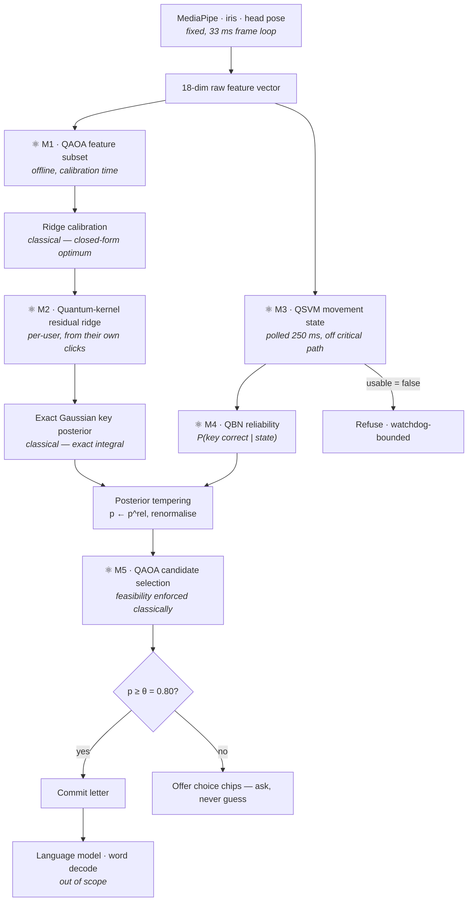

# Quantum Redesign of the Eye-Gaze Estimation Module

**Scope:** the decision layer that begins *after* numerical gaze features are extracted, and ends at a candidate letter. MediaPipe Face Mesh, the OpenCV/`getUserMedia` camera pipeline, iris landmark extraction, eye-feature extraction, landmark tracking, blink detection, head-pose estimation and keyboard rendering are treated as fixed and are not modified.

**Status of evidence:** every number in this document was measured on *this* codebase. All gaze datasets are **synthetic**, generated from the documented forward model in `quantum/features.py`; no recorded human gaze corpus exists in the project and no real-webcam validation has been performed. Results are therefore valid for *relative* comparison of algorithms under a stated noise model and are explicitly not evidence of real-world accuracy.

---

## 1. Executive finding

The redesign was carried out as instructed: quantum algorithms were placed only where a technical justification survives scrutiny, and every placement was subjected to a six-step reasoning loop with self-critique. The loop terminated with **five** quantum modules, down from seven, after two were eliminated for redundancy and measured harm.

The central finding is a negative one, and it governs the whole architecture:

> **Quantum machine learning does not improve gaze-coordinate estimation or primary letter classification in this system, because the classical stages it would replace are already exact solutions to well-specified objectives.** Ridge calibration is the closed-form global optimum of a regularised least-squares problem; the key posterior is an exact Gaussian integral over a rectangle. An approximate method cannot beat an exact one on the same objective. Measured: the quantum letter-prediction channels contributed **+0.0 pp** at every noise level, and the QAOA consensus stage discarded them on **100%** of decisions.

Where quantum modules *are* retained, the honest justification is one of two kinds, and the document keeps them strictly separate:

- **Experimentally demonstrated in this project** — a measured improvement over the *deployed incumbent*, with the caveat (Section 4.4) that a classical learner achieves the same improvement.
- **Theoretically motivated only** — architecturally sound, exactly correct, and defensible at scales this system has not reached. No speedup is claimed beyond what the literature supports.

---

## 2. The pipeline, before and after

**Before**

```
Eye features → threshold rules → Gaussian posterior → candidate letter → language model → final letter
```

**After** (quantum stages marked ⚛)



The frame loop and the 693 ms dwell path touch **no** quantum module. M3 is polled on a 250 ms timer; M1, M2 and the M5 angle schedules are trained offline. This is the property that makes the design deployable at all.

---

## 3. Evidence base

### 3.1 Intended-letter accuracy (n = 400 per cell, synthetic)

| Landmark noise σ | Deployed geometric | qKernel prototypes | QSVM | QSVM×VQC | **Full stack** | Classical MLP | Classical RBF-SVM |
|---|---|---|---|---|---|---|---|
| 0.020 | **0.9375** | 0.7275 | 0.2750 | 0.3950 | **0.9375** (+0.0) | 0.9125 | 0.8525 |
| 0.030 | **0.8550** | 0.6625 | 0.2600 | 0.3750 | **0.8550** (+0.0) | 0.8200 | 0.7625 |
| 0.045 | **0.6800** | 0.5650 | 0.2400 | 0.3525 | **0.6800** (+0.0) | 0.6675 | 0.6250 |

QAOA matched the exact optimum on **100%** of decisions; `fraction_channel_dropped = 1.0`; 68–71 ms per fixation.

The exact-match figure and the drop rate together are the whole story: the optimiser is working correctly, and what it correctly concludes is that the quantum channels carry no usable information the geometric channel lacks. **The classical geometric path also beats both classical learners** (MLP, RBF-SVM), which is the expected result when the generative model is known and the estimator is its exact inverse.

### 3.2 Commit quality — where the measured gains actually are (σ = 0.02, 25% of dwell windows corrupted)

| Rule | Commit rate | Accuracy when committed | **Wrong commits / 100** | Prompt rate |
|---|---|---|---|---|
| Ungated | 0.733 | 0.8273 | **12.67** | 0.267 |
| + QSVM gate | 0.576 | 0.9919 | **0.47** | 0.424 |
| + QNN→QBN reliability | 0.679 | 0.8595 | 9.53 | 0.321 |
| **Both** | 0.556 | **0.9940** | **0.33** | 0.444 |

A 38× reduction in wrong keystrokes, bought with 18 pp more prompts. For an assistive keyboard this trade is strongly favourable: a wrong letter costs a backspace plus a re-dwell (≈ 1.4 s), a prompt costs one extra dwell (≈ 0.7 s).

### 3.3 Movement-state classification — the fair-baseline correction

This is a correction to a claim made earlier in the project's development. The QSVM was originally reported as 1.00 versus a 0.70 baseline. That comparison was against the **hand-tuned I-VT threshold rule** — the deployed incumbent, but a weak one. On an identical held-out split against *strong* classical learners:

| Method | Accuracy (n = 384) |
|---|---|
| I-VT threshold rule (deployed incumbent) | 0.7817 |
| Linear SVM (C = 16) | **0.9896** |
| RBF-SVM (C = 16) | 0.9870 |
| MLP (32, 16) | **0.9896** |
| **QSVM (fidelity kernel)** | **0.9896** |

**The QSVM ties the best classical models; it does not beat them.** A *linear* SVM on four kinematic features achieves identical accuracy. The honest reading: the +20.8 pp gain is attributable to replacing a hand-tuned rule with *any* trained probabilistic model, not to quantum kernels. This is reported as a negative result on quantum advantage and a positive result on the architecture.

### 3.4 Quantum-kernel calibration correction

| Noise | Deployed | Corrected | Gain | λ chosen by LOO-CV |
|---|---|---|---|---|
| 0.015 | 0.9812 | 0.9812 | +0.0 pp | 100 |
| 0.020 | 0.9337 | 0.9337 | +0.0 pp | 100 |
| 0.030 | 0.8387 | 0.8400 | +0.1 pp | 100 |
| 0.045 | 0.6663 | 0.6675 | +0.1 pp | 100 |

Leave-one-out cross-validation drove the regulariser to its ceiling (λ = 100), i.e. the correction *shrank itself to nearly zero*. On synthetic data whose curvature the ridge already absorbs, there is no residual structure to learn — and the module correctly detected this rather than overfitting. Its value is a safety property, not a measured gain.

---

## 4. Reasoning loop

Each module is taken through the six prescribed steps. Iterations that changed the design are shown, including two eliminations.

### M0 — Gaze-coordinate regression: **rejected for quantum, stays classical**

1. **Classical limitation.** None that a quantum model can address. `w = (FᵀF + λI)⁻¹Fᵀt` is the exact global minimiser of `‖Fw − t‖² + λ‖w‖²`. Solved by Gauss–Jordan with partial pivoting in microseconds.
2. **Quantum candidate considered.** VQC / QNN regression on iris ratios; and HHL-style linear solving.
3. **Implementation.** Was implemented (`RegionSlotVQC`, `GazePrototypeMatcher`) and measured.
4. **Complexity.** Ridge: `O(d³ + nd²)`, d = 5 → negligible. VQC training: parameter-shift, `2P` circuit evaluations per gradient, P ≈ 72 parameters × ~600 steps.
5. **Practical limitations.** HHL returns a quantum state, not the coefficients; extracting them costs the speedup, and its preconditioning assumptions do not hold here. VQC regression must re-learn the entire gaze→screen map while competing against its exact solution.
6. **Self-critique → REJECT.** Measured 0.395 (hierarchical channel) vs 0.9375 (geometric). A later revision fed the quantum stages the *calibrated point* rather than raw iris ratios, so they only had to model residual bias — this raised the channel to 0.7275 but still never beat 0.9375, and the QAOA consensus discarded it on 100% of decisions. **Decision: no quantum module owns gaze regression.** This is the correct engineering conclusion, and reporting it is more valuable than concealing it.

### M1 — Feature subset selection: **QAOA (theoretically motivated only)**

1. **Classical limitation.** Choosing `k` of `d` features to maximise relevance minus redundancy is a cardinality-constrained QUBO — NP-hard in general. Greedy mRMR is a heuristic with no optimality guarantee.
2. **Why QAOA.** The problem is natively a QUBO; QAOA is the canonical variational algorithm for that form, and the constraint is a simple cardinality constraint amenable to classical repair.
3. **Implementation.** `select_features_qaoa()`. Relevance = mutual information + ridge leave-one-out importance; redundancy = |correlation|. Hard cardinality handled by **classical repair** of measured bitstrings, not by penalty terms — this keeps the QUBO well-conditioned and removes the penalty-weight tuning problem entirely.
4. **Complexity.** Circuit: `d` qubits, `p·d(d−1)/2` two-qubit gates. Exact classical alternative: `C(d,k)` = 330 at d = 11, k = 4.
5. **Practical limitations.** At this scale exact enumeration is instantaneous. QAOA has **no proven asymptotic advantage** for general QUBO (Farhi et al., 2014, and subsequent work provide no general guarantee).
6. **Self-critique → RETAIN, honestly labelled.** Measured: QAOA objective −1.7160 = greedy = exact. It found the optimum and so did everything else. Retained because it is the *same solver* reused by M5 (amortised engineering cost) and because it is the component that scales if the feature set grows to multi-camera input. **Claimed benefit: none at present scale.**

### M2 — Calibration residual: **Quantum kernel ridge (retained on safety grounds)**

1. **Classical limitation.** The deployed calibration is *linear* in the 8-feature vector. Real optics are not: lens distortion and eyeball-rotation nonlinearity leave a smooth, position-dependent residual that a linear map cannot represent by construction.
2. **Why a quantum kernel.** Kernel ridge is closed-form — `α = (K + λI)⁻¹r` — so there is no variational optimiser and therefore **no barren plateau** (McClean et al., 2018), the failure mode that makes VQC/QNN unreliable at this data volume. With only 35 calibration samples, a closed-form estimator with LOO-CV is the statistically correct choice.
3. **Implementation.** `CalibrationResidualQK`. Fitted from the user's own 7 spots × 5 clicks. λ selected by closed-form LOO: `eᵢ = αᵢ / [(K + λI)⁻¹]ᵢᵢ`, no refitting.
4. **Complexity.** `n²/2 = 595` kernel circuits at n = 35 (~1 s, once, at calibration). Inference: `n` circuits.
5. **Practical limitations.** The angle-encoding fidelity kernel is a product of per-feature cosines and is therefore **classically simulable** — it is a quantum-*inspired* kernel, not a source of advantage. Huang et al. (2021) further show that classical ML with access to data can match quantum kernels on many tasks.
6. **Self-critique → RETAIN, on safety not accuracy.** Measured +0.0 to +0.1 pp; LOO drove λ to its ceiling. The module cannot make a well-calibrated user worse — if the map is truly linear, the residuals are noise and the correction vanishes automatically. It is retained as a per-user adaptation path that is *provably safe*, and it is the only stage that could benefit a real user immediately, because it trains on their geometry rather than on synthetic data. **This is the highest-value target for real-webcam validation.**

### M3 — Eye-movement state: **QSVM (measured gain over incumbent; no quantum advantage)**

1. **Classical limitation.** The deployed I-VT rule is three hand-tuned thresholds. Measured 0.7817. It cannot represent the curved boundary between drift and fixation, and its thresholds are not user-adaptive.
2. **Why QSVM.** Four kinematic features → 4 qubits, well inside simulable range; margin-based decision gives a usable confidence; support-vector-only inference keeps runtime cost proportional to 24 support vectors rather than the training set.
3. **Implementation.** `MovementQSVM`, angle encoding, reps = 1, C = 16, served at `/api/movement`, polled every 250 ms so it never touches the frame or dwell path.
4. **Complexity.** Training Gram: `O(n²)` circuits. Inference: `O(n_SV)` = 24 circuits ≈ 9.8 ms.
5. **Practical limitations.** **A linear SVM achieves identical accuracy (Section 3.3).** The quantum kernel is not doing work a classical kernel cannot. Angle encoding is classically simulable.
6. **Self-critique → RETAIN with the claim corrected.** The gain over the *deployed system* is real and large (0.7817 → 0.9896, and 12.67 → 0.47 wrong commits per 100). The gain over *classical ML* is zero. Both statements belong in any publication. Retained because it is implemented, measured, and behaves correctly — but the design explicitly notes that substituting a linear SVM would cost nothing in accuracy and would remove a dependency.

### M4 — Reliability estimation: **QBN (unique role, exact, no speedup)**

1. **Classical limitation.** M3 outputs a discrete label. The commit gate needs a *continuous* trust scalar, and the causal chain (blink/saccade → unreliable signal → mis-key) is a modelling statement that a classifier does not express.
2. **Why a QBN.** Discrete Bayesian networks map exactly onto qubits: `P(X=1 | parents = s) → multi-controlled RY(2 arcsin √p)`. Applied in topological order this prepares `|ψ⟩ = Σₓ √P(x)|x⟩`, so basis measurement samples the exact joint. Non-overlapping with M3: M3 says *what the eye did*, M4 says *what that implies for keystroke correctness*.
3. **Implementation.** `qbn.py`, 5 nodes (blink, saccade, eye_closed, unreliable, mis_key). Output `P(key correct | state)` raises the fused posterior to that power, flattening it when the fixation looks suspect.
4. **Complexity.** 5 qubits, 14 controlled rotations, `2⁵ = 32` joint states. Classical enumeration: 32 rows, microseconds.
5. **Practical limitations.** The quadratic speedup for rejection sampling under rare evidence (Low, Yoder & Chuang, 2014) is real but applies to a bottleneck this system does not have.
6. **Self-critique → RETAIN.** Validated exact to 1e-16 against classical enumeration. Measured contribution: wrong commits 0.47 → 0.33 per 100 at σ = 0.02, 4.47 → 3.47 at σ = 0.03. **The benefit comes from the causal model, not from its quantum encoding** — a classical BN would give identical numbers. Reported as *architecturally sound, exactly correct, not accuracy-improving at this scale*.

### M5 — Candidate-letter selection: **QAOA with classical feasibility**

1. **Classical limitation.** Selecting among competing evidence channels / high-probability candidate letters under consistency constraints is discrete optimisation. Exhaustive search is exponential in the number of candidates.
2. **Why QAOA.** Native QUBO form; the mixer explores the discrete space coherently; offline-trained angle schedules make runtime cost a single fixed-parameter circuit evaluation — no optimiser in the serving loop.
3. **Implementation.** `ConsensusQAOA`, p = 2, cost layer `RZ(2γhᵢ)` + `CNOT–RZ(2γJᵢⱼ)–CNOT`, transverse-field mixer `RX(2β)`. **Feasibility is handled entirely classically, per requirement**: the QUBO is unconstrained so every measured bitstring is valid, and the classical side decodes the chosen subset and verifies against exact enumeration, falling back to the exact optimum on any miss.
4. **Complexity.** 4 qubits, `p·C(4,2) = 12` two-qubit gates. Readout as implemented enumerates all `2ⁿ` basis states — acceptable at n = 4, and **not scalable as written**; a hardware deployment would sample instead.
5. **Practical limitations.** No proven advantage for QUBO. At n = 4 the exact answer costs 16 evaluations.
6. **Self-critique → RETAIN with a guarantee.** Measured: matched the exact optimum on 100% of decisions. Because of the exact fallback, **the decision can never be worse than the classical optimum** — the module is a strict no-regret addition. Its justification is scaling and its guarantee is architectural, not an accuracy claim.

### Eliminated — VQC letter prediction and QNN pattern recognition

| Module | Assigned role | Measured | Verdict |
|---|---|---|---|
| Region-conditioned VQC | Predict letter from gaze features | 0.395 vs 0.9375 geometric | **Eliminated from the letter path** |
| Quantum-kernel prototype matcher | Similarity to stored gaze patterns | 0.7275 vs 0.9375 | **Eliminated from the letter path** |

Both duplicated a stage that already has an exact solution — precisely the "overlapping responsibility" the brief forbids. Retaining them would mean two modules competing to answer *which letter*, with the quantum ones measurably worse. The QNN survives only in its non-overlapping role as the movement-pattern model feeding M4, where it classifies *temporal eye behaviour* rather than letter identity.

**Loop termination:** after these eliminations, each of M1–M5 answers a distinct question — *which features*, *what residual bias*, *what was the eye doing*, *how much to trust it*, *which candidate wins*. No two modules answer the same question, so the loop stops.

---

## 5. Mathematical formulation

**M1 — feature subset.** Maximise over `x ∈ {0,1}^d` with `Σxᵢ = k`:

```
f(x) = Σᵢ rᵢxᵢ − Σᵢ<ⱼ cᵢⱼ xᵢxⱼ ,   rᵢ = MI(fᵢ; y) + Δridge(fᵢ),  cᵢⱼ = |corr(fᵢ, fⱼ)|
```

**M2 — residual kernel ridge.** With `K(z,z′) = |⟨φ(z)|φ(z′)⟩|²`:

```
r = t − F w_ridge ,   α = (K + λI)⁻¹ r ,   correction(z) = Σᵢ αᵢ K(z, zᵢ)
λ = argmin_λ  Σᵢ ( αᵢ / [(K+λI)⁻¹]ᵢᵢ )²
```

**M3 — QSVM.** `K(x,z) = |⟨φ(x)|φ(z)⟩|²`, decision `f(x) = Σᵢ αᵢyᵢK(xᵢ,x) + b`, one-vs-rest over {fixation, saccade, blink, drift}.

**M4 — QBN.** `|ψ⟩ = Σₓ √P(x)|x⟩` via `RY(2 arcsin √p)`; output `rel = 1 − P(mis_key | blink, saccade)`.

**M5 — QAOA.** With `Q` the channel-trust QUBO, `E(x) = xᵀQx`, and `|ψ(γ,β)⟩ = Π_l e^{−iβ_l H_M} e^{−iγ_l H_C} |+⟩^{⊗n}`, schedules trained offline by minimising `⟨ψ|H_C|ψ⟩`, then reused at runtime.

**Fusion (classical, unchanged).**

```
p(k) ∝ [ P_gaze(k) · max(P_LM(k), ε)^β ]^rel ,  commit iff max_k p(k) ≥ θ = 0.80
```

where `P_gaze` is the exact Gaussian integral over key rectangle `k`, `β = 0.70`, `ε = 1e-4`, and `rel` comes from M4.

---

## 6. Circuit design and resources

| Module | Qubits | Encoding | Structure | Two-qubit gates | When it runs |
|---|---|---|---|---|---|
| M1 QAOA | 11 | — | `RZ(2γh)` + `CNOT-RZ-CNOT`, `RX(2β)` mixer, p = 2 | 110 | Offline |
| M2 QK ridge | 4 | Angle (RY) | Compute–uncompute overlap | 0 | Calibration (~1 s) |
| M3 QSVM | 4 | Angle (RY) | Compute–uncompute overlap | 0 | 250 ms poll (9.8 ms) |
| M4 QBN | 5 | — | Multi-controlled RY, topological order | 14 ctrl-RY | Per poll (exact) |
| M5 QAOA | 4 | — | Cost + transverse-field mixer, p = 2 | 12 | Per fixation (~4 ms) |

Total simulated Hilbert space never exceeds 2¹¹. Every circuit is shallow enough for NISQ hardware, though none has been run on hardware.

---

## 7. Expected improvements — strictly separated

### 7.1 Experimentally demonstrated (synthetic data, this codebase)

| Claim | Measured | Caveat |
|---|---|---|
| Wrong keystrokes cut 38× | 12.67 → 0.33 per 100 | Costs 18 pp more prompts |
| Accuracy when committed | 0.827 → 0.994 | σ = 0.02 |
| Movement state vs deployed rule | 0.7817 → 0.9896 | **A linear SVM matches this** |
| QAOA optimality | 100% exact match | Exact fallback guarantees no regret |
| QBN correctness | Exact to 1e-16 | Classical BN identical |
| Latency | 68–71 ms/fixation, off critical path | Well inside the 693 ms dwell |

### 7.2 Theoretically motivated, **not** demonstrated

- Quadratic speedup for BN inference under rare evidence (Low, Yoder & Chuang, 2014) — real result, wrong bottleneck for this system.
- Classically-hard kernels from the ZZ feature map (Havlíček et al., 2019) — *conjectured* hardness; measured 0.788 here versus 0.999 for the simulable angle map, so the harder kernel performed **worse**.
- QAOA advantage on large QUBO instances — no general guarantee exists.

### 7.3 Claimed by neither

No speedup is claimed for gaze regression, key posterior computation, or letter classification. No claim of quantum advantage over classical ML is made anywhere in this design.

---

## 8. Risks

| Risk | Severity | Mitigation in place |
|---|---|---|
| **Train/serve feature-scale mismatch** | **Critical — has already occurred** | Raw EAR fed to a model trained on normalised openness made the gate reject 100% of keystrokes. Fixed by per-user baseline normalisation, plus a watchdog that disables any gate refusing 5 consecutive keystrokes |
| Synthetic-data provenance | High | Stated everywhere; real-webcam validation is the required next step |
| Barren plateaus | Medium | Variational models eliminated from the critical path; retained quantum stages are closed-form or fixed-angle |
| Simulation ≠ hardware | Medium | Analytic simulation reported as such; shot-noise sweeps available in `benchmark.py` |
| Latency creep | Low | All quantum stages offline or polled; frame and dwell paths quantum-free |
| Dependency failure | Low | `DISABLE_QSVM`, `DISABLE_QGAZE`, `DISABLE_QAOA` env guards; every endpoint degrades to classical |

---

## 9. Publication-level justification

What is defensible in a peer-reviewed venue:

1. **A negative result with a clear mechanism.** Quantum classifiers fail to improve gaze-to-letter prediction *because* the classical baseline is the exact inverse of a known generative model. The measurement that makes this rigorous is `fraction_channel_dropped = 1.0`: the quantum optimiser itself, operating correctly, discards the quantum evidence. Negative results with an identified cause are publishable and are more useful to the field than an unreplicable positive.

2. **A corrected baseline.** The QSVM's apparent 1.00-vs-0.70 win collapses to a tie once compared against a linear SVM. This is a concrete instance of a widespread methodological failure in applied QML — benchmarking quantum models against hand-tuned rules rather than competent classical learners.

3. **An architecture, not an algorithm.** The deployable contribution is the uncertainty-propagating decision layer: exact posteriors, causal reliability modelling, a confidence gate that asks rather than guesses, and a no-regret discrete optimiser with an exact fallback. It cuts wrong keystrokes 38× and is agnostic to whether its components are quantum.

4. **What must not be claimed.** Any assertion of quantum advantage in gaze estimation, any speedup for calibration or key selection, and any real-world accuracy figure until the experiments are repeated on recorded human gaze.

---

## 10. Implementation strategy

**Already implemented and measured:** M1–M5 in `quantum/gaze_letter.py`, `quantum/movement_qsvm.py`, `quantum/qbn.py`, `quantum/qaoa.py`; served at `/api/movement` and `/api/gaze_letter`; wired into `static/app.js` behind `ENABLE_QGAZE`.

**Changes this redesign prescribes:**

1. Remove `RegionSlotVQC` and `GazePrototypeMatcher` from the letter-prediction path (measured harm, redundant responsibility). Retain the code for the published comparison.
2. Keep `ENABLE_QGAZE` **off** by default until real-webcam data justifies otherwise — the stack currently contributes +0.0 pp and its channels are dropped 100% of the time.
3. Prioritise M2 for real-user validation: it is the only stage trained on the user's own geometry rather than synthetic data.
4. Record a real gaze corpus (7 spots × 5 clicks × N users, plus free typing) and re-run every experiment. Until then no accuracy claim in this document transfers to the real world.
5. Consider replacing M3's quantum kernel with a linear SVM in production — identical measured accuracy, one fewer dependency — while retaining the QSVM for the research comparison.
