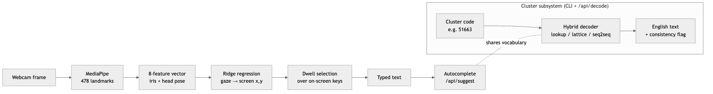
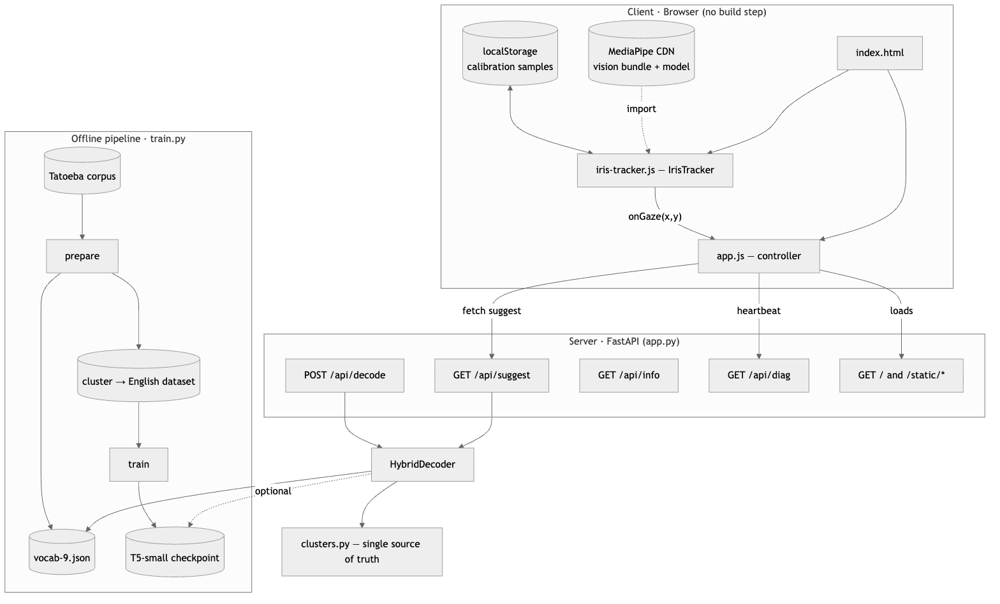
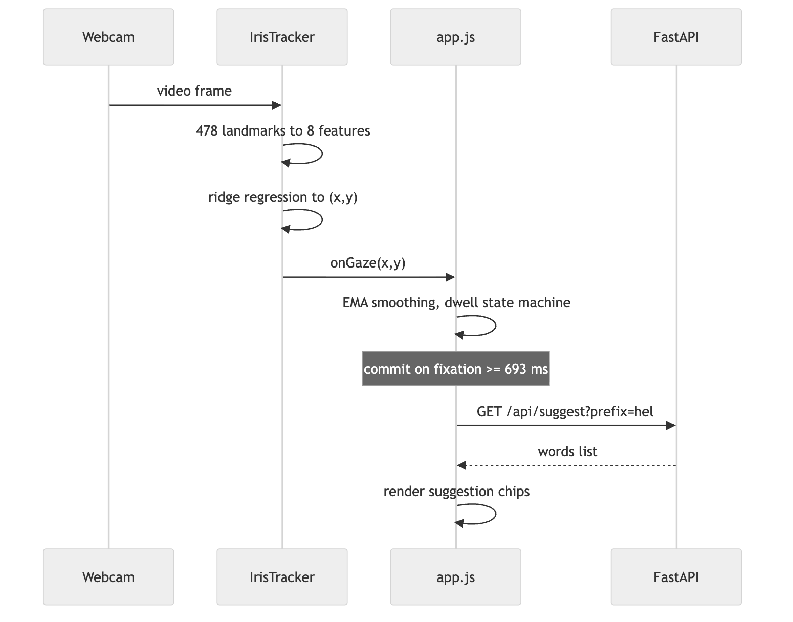
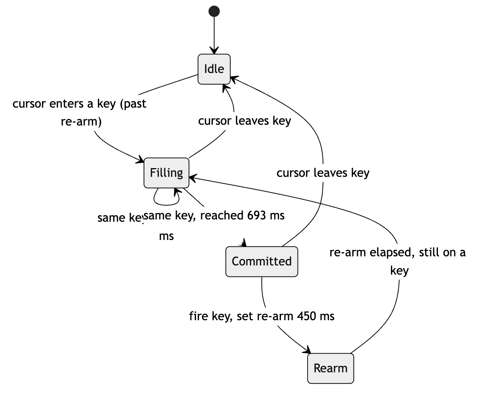
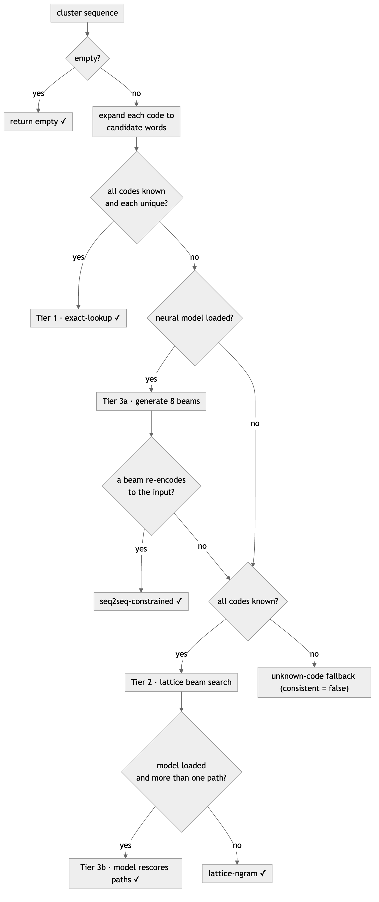

```{=html}
<div class="toc">
<h1>Table of Contents</h1>
<table class="toctable">
<thead><tr><th>S.&nbsp;No.</th><th>Chapter / Title</th><th>Page</th></tr></thead>
<tbody>
<tr><td>1</td><td>Introduction</td><td>__P1__</td></tr>
<tr><td>2</td><td>Background and Related Work</td><td>__P2__</td></tr>
<tr><td>3</td><td>System Architecture and Design</td><td>__P3__</td></tr>
<tr><td>4</td><td>Gaze-Tracking Subsystem</td><td>__P4__</td></tr>
<tr><td>5</td><td>Cluster Encoding and the Hybrid Decoder</td><td>__P5__</td></tr>
<tr><td>6</td><td>Web Application, Training Pipeline, and API</td><td>__P6__</td></tr>
<tr><td>7</td><td>Testing, Verification, and Observed Behaviour</td><td>__P7__</td></tr>
<tr><td>8</td><td>Conclusion: Self-Review, Limitations, and Future Work</td><td>__P8__</td></tr>
<tr><td>&mdash;</td><td>References</td><td>__PR__</td></tr>
</tbody>
</table>
</div>
```

# Chapter 1 — Introduction

## 1.1 Background and Motivation

Typing is still overwhelmingly a manual act. It assumes a keyboard, two working hands, and the fine motor control to move between keys — a set of assumptions that quietly excludes anyone who cannot use their hands reliably, and that breaks down in ordinary situations such as sterile clinical settings, hands-occupied workflows, or shared surfaces where physical contact is undesirable. Gaze is an attractive alternative channel because people already look at what they intend to select; the eyes lead the hands during almost every pointing task. If the point a person is looking at on a screen can be recovered accurately enough, the look itself can stand in for the click.

The obstacle has traditionally been cost. Reliable gaze interaction has historically depended on dedicated infrared eye-trackers, which are expensive, need their own calibration hardware, and rarely leave the lab or the specialist clinic. This project takes the opposite starting position: it assumes nothing beyond an ordinary laptop webcam and a modern browser. Everything the system needs — face and iris localisation, gaze estimation, calibration, selection, and text decoding — is built on commodity components and runs locally, without a build step on the client and without proprietary tracking hardware.

## 1.2 Problem Statement

Estimating gaze from a plain webcam is inherently imprecise. A commodity camera sees a low-resolution eye region, the iris moves only a few pixels between one screen region and the next, and head motion contaminates the signal. The practical consequence is a gaze estimate whose error is large relative to the size of a conventional on-screen key. Any webcam gaze keyboard therefore has to reconcile two facts that pull against each other: selection targets should be large so that an imprecise gaze can still land on them, yet the alphabet has twenty-six letters that must all be reachable.

One well-known way to resolve this tension is to stop insisting that each key hold a single letter. If several neighbouring letters share one large key — a spatial *cluster* — then a word no longer maps to a unique sequence of letters but to a shorter sequence of cluster identifiers, exactly as the classic mobile "T9" keypad mapped three or four letters onto one digit. This buys generous, gaze-friendly targets at the price of ambiguity: the cluster sequence for a word is not, on its own, enough to recover the word. The central technical problem this project addresses is therefore twofold — *estimate gaze well enough to select large targets from a webcam*, and *decode the resulting ambiguous, compressed input back into the intended English text without guessing something the user never looked at*.

## 1.3 Objectives

The work set out to build, end to end, a working touchless typing system rather than an isolated component. Concretely, the objectives were:

1. To implement a webcam-only gaze estimator that requires no infrared hardware and no WebGL, mapping iris and head geometry to on-screen coordinates through a lightweight, user-calibrated model.
2. To provide a dwell-based selection mechanism over an on-screen keyboard, so that fixating on a target is sufficient to commit it, with no clicks or key presses.
3. To design a decoder that translates the compressed cluster input back to English while *guaranteeing* that its output is consistent with what the user actually gazed, so that a neural language model can disambiguate but can never hallucinate an off-target word.
4. To supply the full supporting pipeline — corpus preparation, model training, command-line inference, and quantitative evaluation — so that the decoder can be reproduced and measured rather than merely demonstrated.
5. To expose the whole system through a small web application that runs locally and degrades gracefully when the camera is unavailable.

## 1.4 Scope and Contributions

The repository realises the objectives above as three cooperating subsystems: a browser-side gaze tracker, a Python cluster-encoding and decoding library, and a training pipeline built on the Hugging Face ecosystem, all tied together by a small FastAPI server. It is worth stating precisely what the delivered system does, because the project explores *two* input modalities that share one engine.

The **gaze and selection engine** is common to both. It localises 478 facial landmarks per frame with MediaPipe's Face Landmarker, derives an eight-dimensional feature vector from the irises and head pose, and maps that vector to screen coordinates with a ridge-regression model fitted to a short per-user calibration. A fixation held past a dwell threshold commits the target under the smoothed cursor.

The **cluster-constrained hybrid decoder** is the project's principal contribution. It resolves the ambiguity of cluster input in three ordered tiers — deterministic lookup, a constrained n-gram lattice search, and optional sequence-to-sequence disambiguation — under a hard invariant: every accepted hypothesis must re-encode to exactly the cluster sequence that was entered. This decoder is fully implemented, is driven by a 16,839-word frequency vocabulary built from a Tatoeba-derived corpus of roughly 173,000 sentences, and is reachable both from the command line and through an HTTP endpoint. A fine-tuned T5-small checkpoint is included so that the neural tier can be exercised without retraining.

The **deployed web keyboard**, in its current form, presents a full individual-letter QWERTY layout and enters letters directly, augmenting each partial word with frequency-ranked autocomplete drawn from the same vocabulary. This modality trades the large cluster targets for exactness of entry, and reuses the identical gaze, dwell, and calibration machinery. The relationship between these parts is sketched in Figure 1.1.

{width=6.5in}

*Figure 1.1 — High-level system overview. A single gaze-and-dwell engine feeds the on-screen keyboard; the cluster-constrained decoder is a parallel subsystem that shares the frequency vocabulary and is exposed through the CLI and the `/api/decode` endpoint.*

> **[Screenshot placeholder 1.1]** — The running web keyboard: QWERTY layout, live gaze cursor with dwell ring, typed text, and autocomplete suggestions.

In summary, the contributions of the internship are: (i) a self-contained, hardware-free webcam gaze estimator with per-user calibration and graceful mouse fallback; (ii) a novel three-tier decoder whose neural component is provably prevented from contradicting the user's input; (iii) a reproducible corpus-to-model pipeline with a quantitative evaluation harness; and (iv) an integrated local web application exposing the system through a minimal API.

## 1.5 Organisation of the Report

The remainder of the report proceeds as follows. Chapter 2 situates the work against existing eye-typing and gaze-estimation approaches and explains the ambiguity problem in more depth. Chapter 3 presents the overall architecture and the main engineering decisions that shaped it. Chapters 4 to 6 describe the implementation in detail — the gaze-tracking subsystem, the cluster encoding and hybrid decoder, and the web application together with the training pipeline and API. Chapter 7 documents how the system was tested and what behaviour was actually observed, and is careful to separate verified behaviour from properties that remain to be measured. Chapter 8 closes with a self-review that weighs the design's strengths against its limitations and sets out concrete future work.

```{=openxml}
<w:p><w:r><w:br w:type="page"/></w:r></w:p>
```

# Chapter 2 — Background and Related Work

This chapter frames the three technical areas the project draws on: dwell-based eye typing as an interaction style, webcam gaze estimation as a sensing problem, and the reconstruction of text from an ambiguous, reduced-key input. In keeping with the scope of the report, the references cited here are limited to the tools, models, and datasets the implementation actually uses or names in its source.

## 2.1 Eye Typing and Dwell-Based Selection

Selecting an on-screen target with the eyes raises an immediate difficulty that mouse and touch do not have: there is no natural "click." The eyes are always pointing somewhere, so a system that fires whenever gaze crosses a key would trigger continuously — the so-called Midas-touch problem, where every glance is unintentionally treated as a command. The standard remedy, and the one this project adopts, is *dwell*: a target is committed only after gaze rests on it continuously for a fixed threshold. Dwell converts an involuntary, ever-present signal into a deliberate one by requiring the user to hold their attention.

The design tension in any dwell system is the threshold itself. Too short, and ordinary reading glances commit unintended keys; too long, and typing becomes tiring and slow. The implementation exposes this as a single tunable constant (`DWELL_MS`, currently 693 ms) and pairs it with a re-arm interval (`REARM_MS`, 450 ms) that briefly disables the key just committed, so that holding a gaze on a doubled letter does not fire twice in immediate succession. A visible ring animation fills over exactly the dwell duration, giving the user continuous feedback on how close a selection is to committing. These are small but consequential interaction choices, and Chapter 4 returns to them in the context of the selection loop.

## 2.2 Webcam Gaze Estimation

Gaze estimation splits cleanly by hardware. Dedicated eye-trackers illuminate the eye with infrared and exploit the corneal reflection to recover gaze direction with high precision, but they require specialised, and usually costly, equipment. Webcam-based estimation removes that hardware and, with it, the precision — a commodity RGB camera provides only a low-resolution view of the eye region under uncontrolled lighting, so the achievable accuracy is coarse. The trade-off this project accepts is deliberate: universal availability in exchange for a gaze estimate that must be compensated for elsewhere in the system.

Two representative webcam approaches bracket the design space. WebGazer [12] popularised in-browser eye tracking by regressing gaze from eye-region image features, and notably refreshes its model opportunistically from ordinary cursor interactions. The present system is explicitly built as an alternative to WebGazer, as its own source notes. Rather than learning from raw eye pixels, it delegates face and iris localisation to MediaPipe's Face Landmarker [11], which returns 478 facial landmarks per frame including dedicated iris-ring points, and then computes gaze from the *geometry* of those landmarks — where each iris sits within its eye opening, together with nose position and inter-eye distance as proxies for head translation and distance. This lands the project between the two extremes: it borrows a robust, pretrained landmark detector but keeps the gaze mapping itself deliberately small and interpretable. Table 2.1 summarises the comparison.

| Property | Dedicated IR tracker | WebGazer-style [12] | This project |
|---|---|---|---|
| Extra hardware | Infrared camera + illuminators | None (webcam) | None (webcam) |
| Sensed signal | Corneal reflection | Eye-region image features | MediaPipe iris/eyelid landmark geometry [11] |
| Gaze mapping | Vendor pipeline | Regularised regression on image features | 8-feature ridge regression |
| Calibration | Guided, hardware-assisted | Implicit / click-based | Explicit 7-point + click refinement |
| Accuracy | High | Coarse | Coarse, compensated by large targets |

*Table 2.1 — Webcam gaze-estimation approaches compared with this project.*

MediaPipe was chosen for a second, practical reason visible in the code: it runs on the GPU when WebGL is available and falls back automatically to a CPU/WASM delegate when it is not, so the tracker still functions in browsers with hardware acceleration disabled. That robustness matters for a tool intended to run on arbitrary laptops.

## 2.3 Reduced-Key Text Entry and Its Ambiguity

Making gaze targets large enough to hit reliably means putting more than one letter on each key. This is the same compromise the mobile-phone "T9" keypad made, where the digits 2–9 each carried three or four letters and a word became a sequence of digit presses. Grouping letters this way is what the project calls *clustering*: the QWERTY layout is partitioned into a handful of spatial regions, and each region is assigned a single identifier. A word is then no longer a string of letters but a shorter string of cluster digits — "hello" becomes `51663` in the nine-cluster layout.

The cost of this compression is ambiguity, and it is not incidental — it is information-theoretic. Because several letters share one digit, distinct words collapse onto the same code: the source comments give `742` decoding to both "cat" and "car," and `511` to both "fee" and "gee." No decoder, however sophisticated, can always recover which word was meant from the code alone, since the information was discarded at entry. This observation shapes the entire decoder design in Chapter 5: the realistic goal is not perfect inversion, which is impossible, but recovery of the *most probable* word consistent with the code, backed by a language model, and never a word that fails to match the code at all. The project is careful to state this limit explicitly rather than overclaim accuracy.

## 2.4 Sequence-to-Sequence Reconstruction

Turning a full cluster sequence back into a sentence can be posed as translation between two languages — a "cluster language" and English — and treated with the same encoder–decoder machinery used for machine translation. The project frames it exactly this way, prefixing every input with the task string `translate Cluster to English:` and fine-tuning a pretrained sequence-to-sequence transformer. Two model families are supported through the training script: T5 [13], whose text-to-text formulation makes the translate-prefix framing natural, and BART [14], a denoising autoencoder well suited to reconstructing fluent text from corrupted input. The checkpoint shipped in the repository is a fine-tuned T5-small. Training, tokenisation, generation, and evaluation are all handled through the Hugging Face Transformers library [15], and translation quality during training is scored with sacreBLEU [16] alongside an exact-match metric.

The important subtlety, and the reason the neural model is not used on its own, is that a free-running sequence-to-sequence decoder can produce fluent English that does not correspond to the entered clusters at all — it can "hallucinate" off-target words that merely read well. Chapter 5 shows how the project contains this by admitting a neural hypothesis only when it re-encodes to the exact input clusters, so the model contributes disambiguation power without being trusted to respect the input on its own.

## 2.5 Positioning of This Work

Set against these strands, the project's position is a specific combination rather than a single new algorithm. It keeps webcam gaze estimation but grounds it in landmark geometry and a small calibrated regressor instead of raw-pixel regression. It embraces reduced-key entry for its gaze-friendly targets, and then confronts the ambiguity that entails head-on, rather than leaving it to a black-box model. Its distinguishing idea is the *cluster-consistency constraint* — the guarantee, enforced by construction, that whatever the decoder returns will re-encode to precisely what the user looked at. The training and evaluation pipeline that accompanies the decoder means the design can be reproduced and measured, not merely asserted. The chapters that follow describe how these pieces are assembled and implemented.

```{=openxml}
<w:p><w:r><w:br w:type="page"/></w:r></w:p>
```

# Chapter 3 — System Architecture and Design

## 3.1 Architectural Overview

The system is organised as a thin, stateless server serving a self-contained browser client, with an offline pipeline standing behind both to produce the data and model artefacts they depend on. Nothing about the gaze sensing touches the network: face detection, feature extraction, gaze estimation, calibration, and dwell selection all execute in the browser, and the only traffic to the server is short JSON requests for word suggestions, a diagnostic heartbeat, and — for the cluster subsystem — decoding. This division is a deliberate privacy and scalability choice, examined in Section 3.5. Figure 3.1 shows the components and their connections.

{width=6.5in}

*Figure 3.1 — Component architecture. The browser client runs the entire gaze pipeline locally; the FastAPI server is stateless and holds only the loaded decoder. The offline pipeline produces the vocabulary and the optional neural checkpoint.*

## 3.2 Component Responsibilities

Each source file owns a single, well-bounded concern, and the dependencies between them form a shallow, acyclic graph.

- **`clusters.py`** defines the letter-to-cluster maps for the 9-, 7-, 5-, and 3-cluster layouts and the three functions built on them: `encode_word`, `encode_text`, and `is_consistent`. It is imported by every other Python module and by nothing outside the project. Its role as the *single source of truth* is the most important structural decision in the codebase and is discussed in Section 3.5.
- **`decoder.py`** holds `HybridDecoder`, which loads the frequency vocabulary and, optionally, the fine-tuned model, and exposes `decode` and `suggest`. It depends only on `clusters.py` and the standard library, except when a neural model is requested, at which point it lazily imports PyTorch and Transformers.
- **`app.py`** is the FastAPI application. It constructs exactly one `HybridDecoder` at startup, wires five routes, and mounts the static directory. It carries no per-request or per-session state of its own.
- **`train.py`** is the offline command-line pipeline, with four subcommands — `prepare`, `train`, `infer`, `eval` — that share the encoding logic in `clusters.py` so that data preparation and serving cannot drift apart.
- **`static/iris-tracker.js`** implements the `IrisTracker` class in isolation from the rest of the UI; it knows about MediaPipe, calibration, and gaze regression, and communicates outward only through three callbacks (`onGaze`, `onFace`, `onReady`).
- **`static/app.js`** is the front-end controller. It owns the keyboard, dwell logic, typed-text state, autocomplete requests, calibration UI, and the mouse fallback, and treats the tracker as a black box behind its callbacks.

## 3.3 Module Interaction and Data Flow

Three distinct flows run through the system. The first two are offline and produce artefacts; the third is the live interaction loop.

**Preparation and training.** `train.py prepare` reads the first column of the Tatoeba TSV, normalises each sentence to the letters-and-spaces alphabet the keyboard can actually produce, encodes it to a cluster sequence with `encode_text`, and writes both a paired dataset and the `vocab-N.json` frequency table (unigrams and bigrams). `train.py train` then fine-tunes a T5 or BART model on those pairs. Because both steps call the same encoder, the "cluster language" seen during training is byte-for-byte the one produced at inference.

**Live typing loop.** During use, the tracker emits a smoothed gaze coordinate roughly once per camera frame; the controller runs the dwell state machine over the on-screen keys and, on commit, appends a letter and requests autocomplete. Figure 3.2 traces one cycle.

{width=5.5in}

*Figure 3.2 — One iteration of the live typing loop. All gaze computation is client-side; the only server call is stateless autocomplete.*

**Cluster decoding.** The decoder subsystem is invoked separately — from `train.py infer`/`eval` or the `/api/decode` endpoint — and never appears in the live loop of the current letter-based UI. Its internal control flow through the three tiers is the subject of Chapter 5; at the architectural level it is a pure function from a cluster string to a `DecodeResult`, with `clusters.py` consulted to enforce consistency.

## 3.4 Technology Stack

The stack was chosen to keep the client dependency-free at build time and the server small. Table 3.1 lists the principal technologies and why each is present.

| Layer | Technology | Role in the system |
|---|---|---|
| Web server | FastAPI + Uvicorn | Routing, JSON validation, static file serving |
| Request schema | Pydantic | Validates the `/api/decode` body (`clusters: str`) |
| Gaze sensing | MediaPipe Tasks Vision [11] | 478-landmark face/iris detection, GPU or CPU/WASM |
| Client | Vanilla HTML/CSS/JS | Keyboard, dwell, calibration — no framework, no bundler |
| Neural decoder | PyTorch + Transformers [15] | Fine-tuned T5-small [13] / BART [14] seq2seq |
| Training data | Datasets, pandas, NumPy | Corpus loading, normalisation, splitting |
| Metrics | Evaluate + sacreBLEU [16] | BLEU and exact-match during training |
| Corpus | Tatoeba (English column) [17] | Source of the vocabulary and training pairs |

*Table 3.1 — Principal technologies and their roles.*

A notable consequence of this stack is asymmetry in dependencies: the base application runs on FastAPI and the vocabulary file alone, and only pulls in the heavy machine-learning stack when a model directory is supplied. A user who only wants the lattice decoder never needs PyTorch installed.

## 3.5 Key Design Decisions

Several decisions recur throughout the implementation and are worth stating plainly here, since later chapters assume them.

**A single source of truth for encoding.** The letter-to-cluster mapping exists in exactly one place, `clusters.py`, and is reused by preparation, training, decoding, and the consistency check. This eliminates an entire class of train/serve-skew bugs: it is structurally impossible for the encoder that generated the training data to disagree with the encoder used to validate a hypothesis at inference, because they are the same function.

**Consistency as a hard invariant, not a heuristic.** The decoder's correctness guarantee — that any accepted output re-encodes to exactly the entered clusters — is enforced with `is_consistent`, and the neural tier is subordinated to it. This turns "the model usually respects the input" into "the model can never violate it," which is the project's central engineering claim.

**Cheap-first tiering with lazy neural loading.** The decoder attempts deterministic lookup, then an n-gram lattice, and only then the neural model, so the expensive path runs solely when the cheaper ones cannot resolve the input. PyTorch and Transformers are imported inside `_load_model`, not at module load, so their cost is paid only when `MODEL_DIR` is set.

**Configuration through the environment, with a guard.** `NUM_CLUSTERS`, `VOCAB_PATH`, `MODEL_DIR`, and `PORT` are read from environment variables, and the decoder refuses to start if the vocabulary's cluster count disagrees with its configuration, failing loudly at construction rather than silently mis-decoding.

**Graceful degradation everywhere the environment is uncertain.** The tracker falls back from GPU to CPU/WASM, the UI falls back from gaze to mouse when the camera is blocked or absent, and it checks for a secure context before even requesting the webcam. Calibration is persisted to `localStorage` and restored on reload, and every ordinary click while gazing quietly contributes a fresh calibration sample. These are not features so much as a consistent posture: assume the environment will be imperfect and keep working.

Together these decisions explain why the system is at once ambitious in its decoder and conservative in its plumbing. The chapters that follow drill into each subsystem, beginning with the gaze tracker.

```{=openxml}
<w:p><w:r><w:br w:type="page"/></w:r></w:p>
```

# Chapter 4 — Gaze-Tracking Subsystem

The gaze tracker is the part of the system that turns a webcam image into a screen coordinate. It is implemented entirely in `static/iris-tracker.js` as the self-contained `IrisTracker` class, and it is deliberately small: a pretrained detector supplies the hard perception, and everything the project adds on top — feature extraction, the gaze mapping, calibration, and selection — is a few dozen lines of interpretable geometry and linear algebra. This chapter follows a single video frame from camera to committed keystroke.

## 4.1 Per-Frame Pipeline

Once started, the tracker runs a `requestAnimationFrame` loop that processes each new camera frame and does nothing on repeated frames, comparing `video.currentTime` against the last processed timestamp to avoid redundant work. Each processed frame passes through four stages: landmark detection, quality assessment, feature extraction, and — if the model is calibrated and the face is well tracked — gaze prediction.

```
loop each animation frame:
    if video has a new frame:
        landmarks <- FaceLandmarker.detectForVideo(video, now)
        if no face:
            report face state "none"; return
        assess face quality -> state in {small, offcenter, ok}
        f <- extractFeatures(landmarks)        # 8-vector
        push f into recentFeatures (ring buffer, length <= 8)
        if fitted and state == "ok":
            x <- clamp01(wx . f);  y <- clamp01(wy . f)
            onGaze(x * innerWidth, y * innerHeight)
```

*Pseudocode 4.1 — The frame loop in `_loop`/`_process`. Prediction is gated on both a fitted model and an "ok" face, so the cursor never jumps on a poorly tracked frame.*

## 4.2 Landmark Acquisition

Perception is delegated to MediaPipe's Face Landmarker [11], loaded as an ES module from a CDN together with its WASM runtime and the `face_landmarker.task` weights. The detector returns 478 landmarks per frame, which crucially include the refined iris rings — the two points at indices 468 and 473 that mark the left and right iris centres. The tracker requests the GPU delegate first and, if that construction throws (for example because WebGL is disabled), silently rebuilds the detector on the CPU/WASM delegate. This single `try/catch` is what lets the system claim it runs "no WebGL required": the failure of hardware acceleration degrades performance but not function.

## 4.3 Feature Extraction

From the raw landmarks the tracker computes an eight-dimensional feature vector intended to capture *where the eyes are pointing* while remaining stable under head movement. The four gaze-bearing features express the iris position as a ratio inside each eye, so that they are invariant to the absolute size and location of the eye in the image. For the left eye, using the outer corner (33), inner corner (133), upper lid (159), lower lid (145), and iris (468):

$$
h_L = \frac{x_{iris} - x_{outer}}{x_{inner} - x_{outer} + \varepsilon}, \qquad
v_L = \frac{y_{iris} - y_{top}}{y_{bottom} - y_{top} + \varepsilon}
$$

with the analogous $h_R, v_R$ for the right eye (indices 362, 263, 386, 374, 473) and a small $\varepsilon = 10^{-6}$ guarding against division by zero when a landmark degenerates. Two further features encode head pose: the nose-tip position $(x_{nose}, y_{nose})$ at landmark 1 tracks head translation, and the inter-outer-corner distance

$$
\text{faceW} = \lVert p_{R.outer} - p_{L.outer} \rVert
$$

tracks head distance from the camera, since a face further away subtends a smaller width. A leading constant completes the vector:

$$
\mathbf{f} = [\,1,\; h_L,\; h_R,\; v_L,\; v_R,\; x_{nose},\; y_{nose},\; \text{faceW}\,].
$$

The constant term makes the subsequent regression *affine* rather than purely linear — it supplies the intercept. The two head features are what allow the linear model to compensate for a user shifting or leaning during a session, a point Chapter 7 revisits when justifying that these features earn their place.

## 4.4 Gaze Mapping by Ridge Regression

Given the feature vector, gaze is predicted by two independent linear maps, one for the horizontal screen coordinate and one for the vertical: $x = \mathbf{w}_x \cdot \mathbf{f}$ and $y = \mathbf{w}_y \cdot \mathbf{f}$, with each result clamped to $[0,1]$ before being scaled to the viewport. The weight vectors are fitted from the user's calibration samples by ridge regression — ordinary least squares with a Tikhonov penalty:

$$
\mathbf{w} = (F^\top F + \lambda I)^{-1} F^\top \mathbf{t},
$$

where the rows of $F$ are the calibration feature vectors and $\mathbf{t}$ the corresponding target coordinates. The regularisation term $\lambda I$ is not cosmetic. The eye features are strongly correlated — the two eyes usually move together, so $h_L \approx h_R$ and $v_L \approx v_R$ — which drives $F^\top F$ towards singularity and, unregularised, produces wild or non-finite weights.

The implementation is careful about the numerics in two ways. First, the linear system is solved by Gauss–Jordan elimination with partial pivoting, and the pivot viability test is *relative* to the matrix scale ($|pivot| < 10^{-10}\cdot\text{scale}$) rather than an absolute epsilon; the source comment explains that an absolute threshold lets numerically-zero pivots through when the entries are large, poisoning the result with NaN or infinity. Second, the regulariser is chosen adaptively and escalated until the system solves cleanly.

```
fit(samples):
    A0 <- sum of f fT           # 8x8 normal-equation matrix
    bx <- sum of f*x,  by <- sum of f*y
    lambda <- 1e-4 * mean(diag(A0))
    repeat up to 6 times:
        A <- A0 + lambda*I
        wx <- solve(A, bx);  wy <- solve(A, by)     # Gauss-Jordan, partial pivot
        if wx and wy are finite: store and return
        lambda <- lambda * 10                        # escalate and retry
```

*Pseudocode 4.2 — The fitting routine `_fit`. Scaling $\lambda$ to the mean diagonal makes the penalty proportional to the data magnitude, and the ten-fold escalation guarantees a solvable, finite system even when the calibration points are nearly collinear.*

## 4.5 Calibration

The weights are personal, so the tracker must be calibrated per user and per seating. Calibration is a click-driven supervised procedure: the user looks at a known on-screen point and clicks it, which pairs the current eye features with that screen target. Two details make the samples usable. Rather than snapshotting a single, possibly blinking frame, `addCalibrationSample` averages the last several frames held in a small ring buffer, producing a stable feature estimate. And each sample stores the target in *normalised* coordinates (divided by the viewport dimensions), so the mapping is resolution-independent.

The front-end organises calibration around seven spots — the four corners plus the mid-left, centre, and mid-right — each clicked five times. The interior spots were an explicit accuracy decision: with corners alone the regression has no supervision where the keys actually are and must extrapolate into the middle of the screen; the added points give it real data there. Calibration is not a one-off. Every ordinary click while gazing, provided the face is well tracked, is quietly folded in as an additional ground-truth sample, so the model keeps refining during normal use, and the sample store is capped at 400 with oldest-first eviction to bound memory and bias the fit toward recent behaviour. Finally, samples and the set of completed spots are persisted to `localStorage` and reloaded on the next visit, so a returning user finds their calibration already live.

## 4.6 Face-Quality Feedback

Because prediction is suppressed unless the face is well tracked, the tracker continuously classifies frame quality and reports it to the UI. The rule is simple and legible: if `faceW` falls below 0.10 the face is too far away ("move closer"); if the nose's horizontal position drifts outside the [0.30, 0.70] band the face is off-centre ("centre your face"); otherwise the state is "ok". The camera-preview border turns green only in the "ok" state, giving the user an unambiguous signal for when calibration clicks will count and when gaze output is live.

## 4.7 Dwell Selection

The controller in `app.js` turns the stream of gaze coordinates into discrete key commits. Two mechanisms sit between the raw prediction and a keystroke. The first is exponential smoothing: each incoming point is blended with the previous cursor position, `point <- point + 0.35*(new - point)`, which trades a little latency for a large reduction in jitter. The second is the dwell state machine, which commits a target only after the smoothed cursor rests on it continuously for the dwell threshold.

{width=4.3in}

*Figure 4.1 — Dwell selection state machine (`updateDwell`). Leaving a key at any point resets the timer; the re-arm interval prevents a held gaze from firing the same key twice in a row.*

A subtle implementation point concerns mouse-mode fallback. When the pointer physically rests on a key, the browser stops emitting `mousemove` events — which is precisely the moment the dwell clock needs to keep advancing. The controller therefore runs a 50 ms interval that re-evaluates the dwell state while in mouse mode. Gaze mode needs no such ticker, because camera frames continue to stream in and drive the state machine on their own. This asymmetry is a small but telling example of the implementation accounting for how its two input sources actually behave rather than assuming they behave alike.

## 4.8 Summary

The gaze subsystem is a study in doing the minimum that works. It leans on a strong pretrained detector for perception, reduces each frame to eight interpretable numbers, and maps them to the screen with a regularised linear model small enough to fit from a handful of clicks yet robust enough to survive collinear features and to compensate for head motion. Its every interface with the wider system — GPU-or-CPU, gaze-or-mouse, calibrated-or-not, secure-context-or-not — is written to keep functioning when the ideal case does not hold. The next chapter turns from getting characters *in* to making sense of them: the cluster encoding and the hybrid decoder.

```{=openxml}
<w:p><w:r><w:br w:type="page"/></w:r></w:p>
```

# Chapter 5 — Cluster Encoding and the Hybrid Decoder

If the gaze tracker is deliberately minimal, the decoder is where the project spends its intellectual budget. Its task is to invert an encoding that is not invertible in general, and to do so in a way that a neural model can strengthen but never subvert. This chapter builds up from the encoding itself to the three-tier decode procedure and the guarantee that ties them together.

## 5.1 The Cluster Encoding

The encoding lives in `clusters.py` and is intentionally trivial to state. Each cluster layout is a dictionary from a group of adjacent QWERTY letters to a single digit; the nine-cluster default assigns `qwe -> 1`, `rtyu -> 2`, `iop -> 3`, `asd -> 4`, `fgh -> 5`, `jkl -> 6`, `zxcv -> 7`, and `bnm -> 9`. A detail worth noting is that the digit 8 never appears in any code: there are eight *letter* groups, labelled 1–7 and 9, and the missing 8 corresponds to the space bar's position in the layout. `build_char_map` flattens the group dictionary into a per-letter table, and `encode_word` walks a lowercased word through it, dropping anything that is not a letter, so that "hello" becomes the digit string `51663`. `encode_text` does the same for a whole sentence while preserving spaces as word boundaries.

The fourth function, `is_consistent`, is the quiet keystone of the whole design. It returns true exactly when a candidate sentence re-encodes to precisely the cluster sequence in question:

```python
encode_text(sentence, num_clusters).split() == cluster_sequence.split()
```

Every correctness claim the decoder makes ultimately reduces to this one line. Because the same `clusters.py` is imported by the data-preparation step, the training pipeline, and the decoder, the encoding used to generate training data, the one used to check a hypothesis, and the one a user's keystrokes imply are guaranteed to be identical.

## 5.2 Vocabulary and the Reverse Index

At construction, `HybridDecoder` loads `vocab-9.json`, which holds a unigram table of 16,839 words with their corpus counts and a bigram table of 166,942 adjacent-word counts, both produced during preparation. From the unigrams it builds the structure the decoder actually queries: a reverse index `code_to_words` mapping each cluster code to the list of vocabulary words that encode to it, sorted by descending frequency. This is the crux of consistency-by-construction — every word filed under a code re-encodes to that code, so any word the decoder retrieves for a code is, by definition, cluster-consistent. The bigram table, together with a precomputed `prev_totals` (how often each word appears as a bigram's first element), supports the language-model scoring described below.

## 5.3 The Consistency Invariant

Section 2.3 established that recovering the intended word from a code alone is impossible when the code is ambiguous — `742` is genuinely both "cat" and "car". The decoder therefore does not attempt the impossible. Its contract is weaker but achievable and, importantly, *safe*: among all sentences that re-encode to the entered clusters it returns the most probable one, and it never returns a sentence that fails to re-encode. The only exception, flagged explicitly, is when a code was never seen in training and no consistent hypothesis exists at all. Everything in the tiered procedure below serves this contract.

## 5.4 Tier 1 — Exact Lookup

The first tier handles the fortunate case in which every code in the sequence maps to exactly one known word. When that holds, there is no ambiguity to resolve and no model to consult: the decoder concatenates the unique words and returns them, tagged `exact-lookup`. On unambiguous vocabulary this tier is correct by construction, and it is tried first precisely because it is both the cheapest and the most certain.

## 5.5 Tier 2 — Constrained Lattice Search

When codes are ambiguous but all still known, the decoder treats the sequence as a word lattice — each position offers several candidate words — and searches for the most fluent path through it with a beam search scored by an n-gram language model. The score of placing `word` after `prev` interpolates a bigram and a unigram estimate, each Laplace-smoothed:

$$
P(w \mid \text{prev}) = 0.7\,\frac{c(\text{prev}, w) + 1}{c(\text{prev}) + V + 1} \;+\; 0.3\,\frac{c(w) + 1}{N + V + 1},
$$

where $V$ is the vocabulary size and $N$ the total unigram count, and the decoder accumulates $\log P$ along each path. The 0.7/0.3 weighting leans on local context where a bigram is available while the add-one smoothing keeps unseen bigrams from collapsing the score to zero.

```
latticePaths(candidatesPerWord):
    beams <- [ ([], 0.0) ]
    for candidates in candidatesPerWord:        # one word position at a time
        next <- []
        for (words, score) in beams:
            prev <- last(words) if words else "<s>"
            for (word, _count) in candidates:
                next.append( (words + [word], score + logProb(word, prev)) )
        beams <- top-16 of next by score          # max(beam_width, rescore_top)
    return beams sorted best-first
```

*Pseudocode 5.1 — The lattice beam search (`_lattice_paths`). Because every candidate re-encodes to its position's code, every complete path re-encodes to the full input; consistency is never checked here because it cannot be violated.*

The beam is kept at `max(beam_width, rescore_top)` — sixteen — so that when the neural tier later wants the top-sixteen paths to rescore, they are already available. With no model loaded, the single best path is returned as `lattice-ngram`; this is the mode in which the base install, without PyTorch, still produces sensible sentences.

## 5.6 Tier 3 — Seq2seq Disambiguation, Two Ways

When a fine-tuned model is present, it contributes in one of two roles, both subordinate to consistency.

In the first role (Tier 3a), the model *generates*. The cluster sequence is prefixed with `translate Cluster to English:` and the model produces eight beams; the decoder walks them in best-first order and accepts the first one that `is_consistent` with the input, returning it as `seq2seq-constrained`. Beams that read fluently but fail to re-encode — the hallucinations Chapter 2 warned about — are simply discarded. This tier is attempted early, immediately after exact lookup, because a consistent neural hypothesis is usually the highest-quality answer available.

In the second role (Tier 3b), the model *rescores*. If generation produced no consistent beam but all codes are known, the decoder falls back to the lattice, takes its top paths, and asks the model which of these already-consistent sentences it finds most likely, choosing the one with the lowest teacher-forced loss. A careful implementation detail here is that the loss is computed *per sentence* — each candidate's mean token cross-entropy is measured under its own label mask — rather than as a single batch loss, so that the ranking reflects individual sentence likelihoods and not an average across the batch. The result is tagged `seq2seq+lattice-rescored`. In both roles the model only ever selects among consistent options; it can improve the choice but cannot introduce an off-target word.

## 5.7 Unknown Codes and the Consistency Flag

The only path that yields an inconsistent result is the one for codes never seen in training. Here the decoder patches each position with its best known candidate where one exists and a `?` marker where none does; if the model produced beams, its top raw beam is returned instead. Either way the result carries `consistent = False`, and the `method` field records which fallback fired (`lookup-with-unknowns` or `seq2seq-unconstrained-fallback`). The flag is not cosmetic — it is the signal a client uses to warn the user that the output is a guess rather than a guaranteed inversion.

## 5.8 The Complete Decode Procedure

Figure 5.1 assembles the tiers into the control flow actually implemented in `decode`. Every terminal marked with a check returns a cluster-consistent result; only the unknown-code terminal does not.

{width=3.4in}

*Figure 5.1 — The full decode control flow (`HybridDecoder.decode`). Cheap and certain tiers are attempted first; the neural model is consulted only when needed and always under the consistency filter.*

## 5.9 The Autocomplete Path

The current letter-based keyboard does not use the cluster decoder at all, and it is worth being explicit about why. When each key carries a single letter, entry is exact — there is no ambiguity to resolve — so the decoder's machinery would be redundant. What the letter keyboard needs instead is word *prediction*, and the decoder exposes a separate, much simpler method, `suggest`, for it: a case-insensitive prefix scan over the same unigram vocabulary, returning the most frequent words that begin with the current partial word. This is served by `/api/suggest` and rendered as the suggestion chips beside the keyboard. The two subsystems thus share one vocabulary but answer two different questions — the decoder asks "what did this ambiguous code most probably mean?", the autocomplete asks "what word is this exact prefix most probably starting?" Keeping them distinct, rather than forcing letter entry through a cluster round-trip, is the honest design: it does not throw away the exactness the letter keyboard just paid for.

## 5.10 Summary

The decoder's value is not any single tier but their ordering and the invariant that spans them. Deterministic lookup handles the unambiguous majority for free; a constrained lattice search resolves ambiguity with a light language model and no neural cost; and an optional sequence-to-sequence model sharpens the choice while being structurally forbidden from contradicting the input. The one place the guarantee cannot hold — genuinely novel codes — is surfaced honestly through a flag rather than hidden. Chapter 6 shows how this decoder, the training that produces its neural tier, and the gaze keyboard are packaged into a runnable application.

```{=openxml}
<w:p><w:r><w:br w:type="page"/></w:r></w:p>
```

# Chapter 6 — Web Application, Training Pipeline, and API

The preceding two chapters described the system's two hardest pieces in isolation. This chapter shows how they are made runnable: the offline pipeline that produces the vocabulary and the neural checkpoint, the small HTTP surface that exposes the decoder and serves the client, and the front-end controller that binds gaze, dwell, typing, and autocomplete into a usable keyboard.

## 6.1 The Offline Training Pipeline

`train.py` is a single command-line program with four subcommands that together take a raw corpus all the way to a measurable model. They are summarised in Table 6.1.

| Subcommand | Input | Output | Purpose |
|---|---|---|---|
| `prepare` | Tatoeba TSV | dataset CSV + `vocab-N.json` | Normalise, encode, build frequency vocabulary |
| `train` | dataset CSV | model directory | Fine-tune a T5/BART seq2seq model |
| `infer` | cluster string | printed decode | Decode via the hybrid decoder or raw beams |
| `eval` | dataset CSV | printed metrics | Measure decoder accuracy on held-out data |

*Table 6.1 — The four subcommands of `train.py`.*

**Preparation.** The most consequential step is text normalisation, because it defines the target alphabet the whole system is trained against. `normalize` lowercases each sentence and strips everything except letters, apostrophes, and single spaces. Apostrophes are kept deliberately — as the source comment notes, "don't" and "dont" encode to the same cluster code anyway, so retaining the apostrophe costs nothing while keeping the English readable. After normalisation, `prepare_dataset` encodes each sentence to its cluster sequence, drops duplicates and empty rows, writes the paired dataset, and accumulates the unigram and bigram counts (seeding each sentence with a `<s>` boundary) into `vocab-N.json`. The vocabulary and the training pairs are thus produced in the same pass, from the same normalised text, guaranteeing they describe one corpus.

**Training.** `train` fine-tunes a pretrained sequence-to-sequence model through the Hugging Face `Seq2SeqTrainer`. The data is split 80/20 with a fixed seed of 13 for reproducibility, inputs are formed by prefixing each cluster string with `translate Cluster to English:`, and generation is enabled during evaluation so that BLEU can be computed on decoded text. The training arguments encode a conventional but sensible recipe — a 2e-5 learning rate, batch size 16, weight decay 0.01, four epochs, and per-epoch evaluation and checkpointing with only the two most recent kept. A custom metrics function reports three quantities each epoch: sacreBLEU [16], an exact-match rate, and mean generation length. The default architecture is BART-large [14], but the smaller T5-small [13] is offered as a CPU/MPS-friendly option, and it is a fine-tuned T5-small that the repository actually ships.

**Evaluation.** The `eval` subcommand is the project's honest self-measurement, and its definitions matter for Chapter 7. It shuffles held-out sentences under the fixed seed, decodes each, and reports four figures:

```
for each held-out (cluster, english) pair:
    result <- decoder.decode(cluster)
    methods[result.method] += 1
    consistent_count += result.consistent
    sentence_hit += (result.text == english)          # exact sentence match
    word_hit  += sum(ref_i == hyp_i) over aligned words # positional word match
report: sentence exact-match %, word accuracy %,
        cluster-consistent %, and the method distribution
```

*Pseudocode 6.1 — The evaluation loop (`evaluate_decoder`). The method distribution is as informative as the accuracy: it reveals how often each decode tier fired.*

No results of running this harness are stored in the repository, and this report does not invent any; what the code provides is a reproducible way to *obtain* those numbers, which Chapter 7 treats as future measurement rather than claimed fact.

## 6.2 The HTTP Surface

`app.py` is a compact FastAPI application. It constructs exactly one `HybridDecoder` at startup — reading `NUM_CLUSTERS`, `VOCAB_PATH`, and `MODEL_DIR` from the environment — and then serves the five routes in Table 6.2. There is no database and no session state; the decoder is the only in-memory object, and each request is independent.

| Method & path | Body / query | Returns | Consumer |
|---|---|---|---|
| `POST /api/decode` | `{clusters: str}` | text, consistent, method, candidates | Cluster subsystem / CLI parity |
| `GET /api/suggest` | `prefix`, `n` | `{words: [...]}` | Letter keyboard autocomplete |
| `GET /api/info` | — | clusters, model-loaded, vocab size | Health / capability check |
| `GET /api/diag` | camera, face, pred, … | `{ok: true}` | Client heartbeat (lands in access log) |
| `GET /` , `/static/*` | — | UI files | Browser |

*Table 6.2 — The five HTTP routes exposed by `app.py`.*

Two touches are characteristic of the codebase's pragmatism. The request schema for decoding is a one-field Pydantic model, so malformed bodies are rejected with a 422 before reaching the decoder. And `/api/diag` is a deliberately trivial endpoint whose value is a side effect: the client pings it with its camera, face, prediction-count, and error state encoded in the query string, so that a developer watching the server's access log sees the client's live state without any extra tooling.

## 6.3 The Front-End Controller

`app.js` owns everything the user actually touches. Its state is a single string of typed text plus a little bookkeeping for the dwell machine and the suggestion chips. When text changes, `renderLabel` redraws the typed line, wrapping each word in a span and marking the word currently being typed with a blinking caret, and then asks for fresh autocomplete. That request path, `refreshSuggest`, guards against a real hazard of fast typing: because each keystroke fires its own asynchronous fetch, an earlier, slower response could otherwise overwrite a later one, so each request carries a monotonically increasing token and a response is applied only if it is still the newest. Accepting a suggestion — by dwell or click — replaces the partial word with the full word and appends a space, so an entire word costs a single selection.

Committing a key routes on its dataset attributes: a suggestion chip completes a word, the backspace key trims the last character, the space key inserts a boundary while refusing to create leading or double spaces, and a letter key appends its letter. The header offers Undo, Clear, and Reset-calibration as ordinary buttons for when a mouse is available. Calibration itself is driven here rather than in the tracker: clicking a spot button positions the target dot and arms a five-click countdown, each click on the dot recording a sample through the tracker, and the two guards — that the tracker is running and the face is "ok" — produce explanatory banners rather than silent no-ops when they fail. The controller also registers the "every click refines" behaviour from Chapter 4 and manages the input-source plumbing: the mouse-mode toggle, the raw-gaze-dot debug overlay, the `mousemove` handler, and the 50 ms dwell ticker that only mouse mode needs.

The most defensive code is in `startGaze`. Before touching the camera it checks for a secure context, and it maps each `getUserMedia` failure to a specific, actionable message — a blocked permission, an absent camera, a camera already in use by another app, or a generic failure that hints at a blocked MediaPipe CDN — and on any failure it releases the camera and drops into mouse mode. When gaze later recovers, an automatic fallback that the system itself engaged is silently switched back off. Finally, the controller exposes a `window.__gaze` object of programmatic hooks — commit a letter, choose a word, read state — which is what made the automated browser testing in Chapter 7 possible without a camera.

## 6.4 The Keyboard Interface

The markup in `index.html` lays out the individual-letter keyboard as three letter rows (`QWERTYUIOP`, `ASDFGHJKL`, `ZXCVBNM`) and a bottom row carrying a wide SPACE and a backspace, each key a flex element so the board fills the viewport and every target stays as large as the layout allows — the single most effective lever for hit accuracy when the keys are small. Above the keys sits the suggestion strip; pinned to the top-right is the camera preview, whose border turns green only when the face is well tracked, with the smoothed gaze cursor and its dwell ring drawn as fixed overlays. The visual theme is a warm, low-saturation yellow-and-orange family: resting keys a subtle yellow with brown glyphs, a gaze-hover shading to orange and a commit flashing a deeper orange, the suggestion chips in cream, and the dwell ring a translucent amber — a palette chosen to sit comfortably with the tan backspace key rather than compete with it. Asset links are cache-busted with a version query so that an updated stylesheet or script is actually picked up on reload.

> **[Screenshot placeholder 6.1]** — Calibration in progress: the orange target dot with its remaining-click count, the green-bordered camera preview, and the diagnostics line showing camera/face/calibration state.

## 6.5 Runtime Configuration and Operation

Operationally the system is a single process. `python app.py` starts Uvicorn on `127.0.0.1:8321` with the lattice decoder alone; prefixing `MODEL_DIR=cluster_to_text_model` additionally loads the neural tier. `NUM_CLUSTERS`, `VOCAB_PATH`, and `PORT` are environment-overridable, and the decoder refuses to start on a vocabulary/cluster-count mismatch. The binding to loopback, rather than a public interface, is not incidental: the webcam requires a secure context, which `localhost` satisfies but a bare LAN address does not, so the deployment choice and the browser's security model are aligned by design. Chapter 7 now turns to how all of this was actually exercised and what was observed.

```{=openxml}
<w:p><w:r><w:br w:type="page"/></w:r></w:p>
```

# Chapter 7 — Testing, Verification, and Observed Behaviour

This chapter reports what was actually done to the system and what was actually observed, and it draws a firm line between the two categories that matter for honesty: behaviour that has been verified by running code, and properties that remain to be measured. Everything in Sections 7.2–7.6 was executed against the repository; Section 7.7 is deliberate about what was not.

## 7.1 Testing Approach

The system spans a Python backend, an HTTP layer, and a browser front-end, so verification was organised along the conventional testing pyramid, with the effort concentrated where defects are cheapest to catch. At the base, backend logic was exercised directly as pure functions. In the middle, the HTTP surface was probed as a running server. At the top, the assembled front-end was driven end to end in a real browser through the programmatic hooks the controller exposes. A useful property of the architecture made this tractable: because the encoding lives in one module and the decoder is a pure function, the most important correctness claims can be checked without any of the browser or camera machinery.

## 7.2 Backend Unit and Integration Tests

The `clusters` and `decoder` modules were tested as functions, and `app.py` was tested as a running server. Twenty-three assertions covered encoding, every decode tier, autocomplete, and the consistency invariant; all passed. Table 7.1 groups them.

| Area | Representative checks | Result |
|---|---|---|
| Encoding (`clusters`) | `hello -> 51663`; spaces preserved; non-letters dropped; a–z covered in all four layouts | pass |
| Consistency | `is_consistent` true for a matching sentence, false for a mismatch | pass |
| Decoder tiers | exact multi-word decode; ambiguous `742` returns a candidate that re-encodes to `742`; empty and whitespace inputs | pass |
| Safety flag | a never-seen code is returned with `consistent = false` | pass |
| Autocomplete (`suggest`) | non-empty prefix returns frequency-ordered matches; empty prefix → `[]`; case-insensitive; respects `n`; unknown prefix → `[]` | pass |

*Table 7.1 — Backend unit and integration test coverage.*

The integration layer was checked by starting the server and calling each route. `GET /api/info` reported the live configuration (nine clusters, no model loaded, 16,839 vocabulary words); `POST /api/decode` returned `"hello how"` for `51663 531` via the `lattice-ngram` method with per-word candidates; `GET /api/suggest?prefix=wor` returned *work, working, world, word, works*; static assets and the index served 200; and a malformed decode body was correctly rejected with 422. These confirm that the decoder's guarantees, verified as functions, survive the HTTP boundary intact.

## 7.3 Front-End End-to-End Tests

The assembled UI was driven in a headless browser through the `window.__gaze` hooks, which let a script commit letters, choose suggestions, and read state without a camera. Sixteen checks covered structure and behaviour: the 28-key QWERTY layout and its letter order, the seven calibration spots, the placeholder state, direct letter entry, live autocomplete, suggestion acceptance with auto-spacing, the space guards against leading and double spaces, safe backspacing on empty text, Undo and Clear, the dwell threshold firing correctly, the calibration guard banner, and word completion by dwelling on a chip.

The first run reported five failures — and the reason is instructive rather than alarming. With no webcam available, the client had fallen back to mouse mode, and the automated browser's own pointer, resting on a key, dwell-typed a stray character into the middle of the test sequence. Once mouse mode was disabled for the test run, removing that spurious input source, all sixteen checks passed. The episode is a small validation of the fallback logic itself (mouse mode did exactly what it is supposed to do) and a reminder that end-to-end tests must control every input the system will honour.

## 7.4 A Defect Found and Fixed

The testing surfaced one genuine defect. The diagnostics line in `index.html` initialised its calibration counter to the literal text `calibration: 0/4`, a leftover from when the layout used four corner points; the calibration procedure had since grown to seven spots, and the live update in `app.js` already computed the count against the true total. The mismatch was cosmetic but misleading — a user glancing at the panel before calibrating would read the wrong target. The fix was a one-word change to the static initial text so that it agrees with the seven-spot procedure, and it was verified by reloading and reading the rendered counter. This is the kind of drift that a single source of truth prevents in the encoding layer but that static UI strings remain prone to; Chapter 8 notes it among the documentation-consistency limitations.

## 7.5 Verification Experiment: The Nose Feature

One design claim deserved a direct check: that the two head-pose features in the gaze vector genuinely earn their place. This was tested analytically rather than with a camera, and it is important to label it as such. A synthetic generator produced feature vectors in which the on-screen point a person looks at is the sum of a gaze component (the iris ratios) and a head-offset component (the nose position) — the physical situation in which moving the head shifts where the same eye rotation lands. The real ridge-regression fitting code was then trained twice on this data, once with the nose features present and once with them blinded, and evaluated on held-out points.

| Configuration | Held-out error (synthetic) |
|---|---|
| Full 8-feature vector | ≈ 0.6 px |
| Nose features blinded | ≈ 76 px |

*Table 7.2 — Ablation of the head-pose (nose) features on synthetic data.*

With head information available the regression compensates almost perfectly; without it the error grows past half a key width, enough to miss the intended key whenever the head drifts. The magnitudes here are illustrative of the *mechanism*, not a claim about real-webcam accuracy, but the direction is unambiguous and rests on the actual fitting code. On that basis the nose features were retained; removing them would have degraded exactly the head-motion robustness the tracker is designed to provide.

## 7.6 Dwell-Timing Verification

Because the dwell threshold is the single most user-visible timing constant, its value was confirmed behaviourally rather than by reading the source. Holding the simulated cursor on a key for 550–600 ms committed nothing, while holding for 820–850 ms committed exactly one character, bracketing the intended 693 ms threshold; the dwell-ring fill animation was separately confirmed to run for the same 0.693 s, so the visual feedback completes precisely as the key fires rather than before or after it.

## 7.7 What Remains Unmeasured

Several properties central to a full evaluation were deliberately not claimed, because they were not measured, and it would be dishonest to present numbers for them.

- **Real gaze accuracy.** The automated environment had no webcam, so end-to-end accuracy with a live face — how often a real gaze lands on the intended key after calibration — was not measured here. It requires a human, a camera, and a controlled protocol.
- **Decoder accuracy on the corpus.** The `eval` harness of Section 6.1 computes sentence exact-match, word accuracy, cluster-consistency, and the method distribution, but no run of it is stored in the repository, and none is fabricated here. Producing those figures on the 173,000-sentence dataset, with and without the neural tier, is the most important immediate measurement.
- **Neural-tier contribution.** The consistency filter's practical benefit — how much the seq2seq model improves disambiguation over the lattice alone — follows directly from the eval above but has not been quantified.
- **Cross-browser and performance behaviour.** Frame rate under the CPU/WASM fallback, decode latency with the model loaded, and behaviour across browsers were not profiled.

Separating these unmeasured properties from the verified behaviour above is itself a result: the system's *logical* guarantees — consistency, the tier ordering, the input safeguards — are checked and hold, while its *empirical* performance is set up to be measured but is not yet asserted. Chapter 8 folds both the strengths and these open measurements into a final self-assessment.

```{=openxml}
<w:p><w:r><w:br w:type="page"/></w:r></w:p>
```

# Chapter 8 — Conclusion: Self-Review, Limitations, and Future Work

## 8.1 Summary of Contributions

The internship produced a complete, self-contained touchless typing system rather than a single isolated component. Three subsystems were built and integrated: a webcam gaze estimator that localises facial and iris landmarks and maps their geometry to the screen through a per-user ridge regression; a cluster-constrained hybrid decoder that inverts an ambiguous, compressed gaze encoding in three ordered tiers under a hard consistency guarantee; and a corpus-to-model training pipeline with a quantitative evaluation harness. These are tied together by a small FastAPI server and an individual-letter QWERTY web keyboard with vocabulary autocomplete. The whole system runs locally on a commodity webcam, with no infrared hardware, no client build step, and graceful fallbacks when the ideal conditions do not hold.

## 8.2 Strengths

Assessed critically, the project's principal strength is the decoder's *consistency invariant*. Where prior gaze keyboards that add language knowledge use it only to predict the next word [1] or to suggest completions [8], this system makes a language model do the harder job of inverting ambiguity, and constrains it so that the neural component can improve a choice but can never return a sentence that fails to re-encode to what the user gazed. That guarantee is enforced by construction, not by heuristic, and it rests on a single source of truth for the encoding shared across preparation, training, and decoding — a structural decision that eliminates train/serve skew rather than merely testing for it.

A second strength is engineering robustness. The tracker degrades from GPU to CPU/WASM, the interface degrades from gaze to mouse, calibration persists and self-refines from ordinary clicks, and the decoder runs in a lattice-only mode with no heavy machine-learning dependencies installed. Third, the accompanying pipeline makes the decoder reproducible and measurable rather than merely demonstrable. Finally, the verified behaviour reported in Chapter 7 — the encoding, every decode tier, the HTTP surface, and the dwell timing — confirms that the system's logical guarantees actually hold in code.

## 8.3 Limitations

The project has real limitations, and naming them precisely is part of an honest assessment.

- **The decoder and the deployed UI are decoupled.** The cluster-constrained decoder, which is the project's core contribution, is reachable only through the CLI and the `/api/decode` endpoint; the shipped web keyboard enters individual letters and calls only autocomplete. The two share a vocabulary but not a live path, and the README still describes the older cluster-typing interface, so the documentation and the running UI have drifted.
- **Empirical performance is unmeasured.** No gaze-accuracy figure with a live face, and no decoder-accuracy figure from the evaluation harness, is claimed, because none was measured in this environment. The system's logic is verified; its performance is not yet quantified.
- **Dwell-only selection can fatigue the eyes,** a cost that systems adding a blink modality [2], [4], [7], [9] partially avoid, and the single fixed dwell time is less forgiving than the adaptive scheme of [3].
- **External and scope dependencies.** The tracker loads MediaPipe from a CDN, so a blocked network disables gaze; the model handles a single face; the corpus and vocabulary are English-only; and the shipped checkpoint is a small T5, chosen for portability rather than maximum quality.
- **No user evaluation.** Unlike the accessibility-focused studies that trial their systems with target users [2], [4], this project has not been evaluated with the population it would ultimately serve.

## 8.4 Future Work

Several of these limitations map directly onto tractable next steps. The most immediate is measurement: running the existing `eval` harness on the full dataset, with and without the neural tier, would turn the decoder's asserted guarantees into reported sentence, word, and consistency figures, and quantify how much the seq2seq model adds over the lattice alone. Reconciling the two input modalities is the next priority — either wiring the cluster decoder back into a cluster-typing UI or unifying both behind one interface — together with updating the README so the documentation matches the code.

Beyond that, the surveyed literature suggests concrete enhancements. An adaptive dwell time in the style of Li *et al.* [3] would ease fatigue and reduce between-key errors; adding blink selection as an optional second channel [2], [4], [7], [9] would relieve the eyes further; and richer next-word language modelling [1], [8] could speed entry. Spoken output, as in the Eye-Move [8] and iChat [9] systems, would extend the keyboard toward a communication aid. Bundling the MediaPipe assets locally would remove the CDN dependency, and, most importantly, a supervised evaluation with users who have motor impairments — the population served by [2] and [4] — would test whether the system's technical guarantees translate into real communicative benefit.

## 8.5 Concluding Remarks

The work set out to make touchless typing possible on ordinary hardware and to do so without letting a language model invent words the user never looked at. Both aims were met in the implementation: gaze is recovered from a plain webcam through interpretable landmark geometry, and the decoder resolves the resulting ambiguity while remaining provably faithful to the input. What remains is to measure the system as thoroughly as it has been built, and to carry it from a verified prototype toward an evaluated assistive tool. The foundation for that next phase — a reproducible pipeline, a guaranteed decoder, and a robust, hardware-free front end — is in place.

```{=openxml}
<w:p><w:r><w:br w:type="page"/></w:r></w:p>
```

# References

[1] B. Waideman and P. T. Aquino Junior, "Augmentative and Alternative Communication Using Eye Tracking and Word Recommendation Using Language Models," *IEEE Latin America Transactions*, vol. 23, no. 8, pp. 637–645, Aug. 2025, doi: 10.1109/TLA.2025.11072932.

[2] M. R. Islam, M. S. Rahman, and A. Sarkar, "Computer Vision Based Eye Gaze Controlled Virtual Keyboard for People with Quadriplegia," in *Proc. 2021 Int. Conf. on Automation, Control and Mechatronics for Industry 4.0 (ACMI)*, Rajshahi, Bangladesh, Jul. 2021.

[3] D. Li, L. Zhang, W. Hu, H. Li, and X. Zhou, "Dwell Time Adaptive Three-Way Text Entry by Gaze," in *Proc. 31st Chinese Control and Decision Conference (CCDC)*, 2019, pp. 5295–[confirm end page].

[4] S. T. S. Rafid, A. J. Ajwad, and A. K. M. A. M. Azad, "Empowering Quadriplegic Patients: A Computer Vision Based Approach for Keyboard Control Using Eye Gaze and Blink," in *Proc. 2023 26th Int. Conf. on Computer and Information Technology (ICCIT)*, Cox's Bazar, Bangladesh, Dec. 2023.

[5] V. I. Saraswati, R. Sigit, and T. Harsono, "Eye Gaze System to Operate Virtual Keyboard," in *Proc. 2016 IEEE Int. Electronics Symposium (IES)*, 2016. [confirm venue]

[6] SK. Aishwariya, M. Harini, A. Elakkiya Dharshini, and B. Harshini, "Eye Gaze Tracking for Virtual Mouse Control Using Computer Vision," Dept. of Artificial Intelligence, Kongu Engineering College, Perundurai, India, n.d. [confirm year/venue]

[7] B. Guru Varshini, A. Manimegalai, S. Dimple Abirami, and S. Kalaiselvi, "Eye-Gaze Controlled Virtual Keyboard Using Blink Detection for Accessible Hands-Free Communication," in *Proc. 2025 Int. Conf. on Computational, Communication and Information Technology (ICCCIT)*, 2025, doi: 10.1109/ICCCIT.2025.09.

[8] Abhaya V, A. S. Bharadwaj, C. C. Bagan, K. Dhanraj, and G. Shyamala, "Eye-Move: An Eye Gaze Typing Application with OpenCV and Dlib Library," in *Proc. Int. Conf. on Automation, Computing and Renewable Systems (ICACRS 2022)*, 2022, pp. 952–957.

[9] K. Kathpal, S. Negi, and S. Sharma, "iChat: Interactive Eyes for Specially Challenged People Using OpenCV Python," in *Proc. 2021 9th Int. Conf. on Reliability, Infocom Technologies and Optimization (ICRITO)*, Noida, India, 2021.

[10] D. A. Padilla, J. A. B. Adriano, J. R. Balbin, I. G. Matala, J. J. R. Nicolas, and S. R. R. Villadelgado, "Implementation of Eye Gaze Tracking Technique on FPGA-based On-screen Keyboard System Using Verilog and MATLAB," in *Proc. 2017 IEEE Region 10 Conference (TENCON)*, Penang, Malaysia, Nov. 2017, pp. 2771 ff.

[11] C. Lugaresi *et al.*, "MediaPipe: A Framework for Building Perception Pipelines," *arXiv:1906.08172*, 2019.

[12] A. Papoutsaki, P. Sangkloy, J. Laskey, N. Daskalova, J. Huang, and J. Hays, "WebGazer: Scalable Webcam Eye Tracking Using User Interactions," in *Proc. 25th Int. Joint Conf. on Artificial Intelligence (IJCAI)*, 2016, pp. 3839–3845.

[13] C. Raffel *et al.*, "Exploring the Limits of Transfer Learning with a Unified Text-to-Text Transformer," *J. Mach. Learn. Res.*, vol. 21, no. 140, pp. 1–67, 2020.

[14] M. Lewis *et al.*, "BART: Denoising Sequence-to-Sequence Pre-training for Natural Language Generation, Translation, and Comprehension," in *Proc. 58th Annu. Meeting of the Association for Computational Linguistics (ACL)*, 2020, pp. 7871–7880.

[15] T. Wolf *et al.*, "Transformers: State-of-the-Art Natural Language Processing," in *Proc. 2020 Conf. on Empirical Methods in Natural Language Processing: System Demonstrations (EMNLP)*, 2020, pp. 38–45.

[16] M. Post, "A Call for Clarity in Reporting BLEU Scores," in *Proc. 3rd Conf. on Machine Translation (WMT)*, 2018, pp. 186–191.

[17] Tatoeba Project, "Tatoeba: Collection of sentences and translations," tatoeba.org (English sentences via the Anki/ManyThings distribution).
